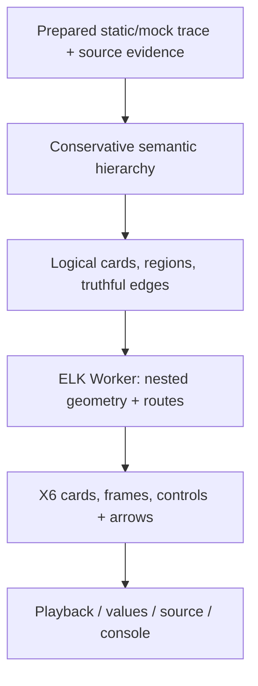
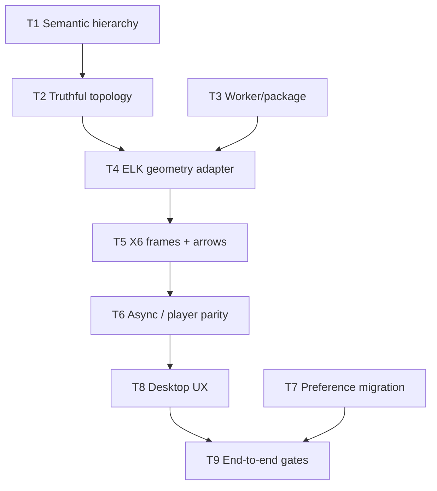

# Code Anime X6 + ELK.js Compound Flow — Implementation Plan

> **2026-10-28 source provenance addendum:** The owner supplied the 2026-10-27 restored 2026-10-26 approved-plan reconstruction; its text is archived at [the historical reference](reference/2026-10-26-elk-approved-plan-restoration.txt). It corroborates the X6 + Dagre + same-origin ELK Worker approach, existing selectors/source/mock cursor protections, and T1–T9 shape. **It is not the original approved-design bytes or the original 76-event fixture.** This more detailed reviewed plan retains later PC-only (existing mobile non-regression), stronger Worker/trace/viewport race guards, independent review and explicit human licensing/redistribution gates. For live progress use [handoff](implementation-handoff-2026-10-28.md) and [task ledger](elk-implementation-tasks.md), not unchecked historical checkboxes.

> **For agentic workers:** REQUIRED SUB-SKILL: Use `superpowers:subagent-driven-development` (recommended) or `superpowers:executing-plans` to implement this plan task-by-task. Steps use checkbox (`- [ ]`) syntax for tracking.

> **Status — COUNCIL-REVIEWED PROPOSAL, 2026-10-27; PC-ONLY SCOPE CONFIRMED, REVISED PLAN APPROVAL PENDING.** This file is a new cross-checked plan, **not** the missing original approved design or a verbatim copy of the historical plan. Five real independent advisors, five newly spawned anonymized peer reviewers, and an EDO-led live challenge/rebuttal round reviewed the proposal; their dissent and limits are recorded below. **No source edits, dependency installations, tests, commits, or GitHub pushes occurred during preparation.** The prior 2026-10-26 `approved` reply covered the archived plan. The owner confirmed the PC-only scope on 2026-10-27; this revised plan still requires approval before implementation.

> **T3 owner approval addendum — 2026-10-28:** The Code Anime project owner
> explicitly authorized use, inclusion and redistribution of `elkjs`/its
> Worker under the applicable open-source license conditions, confirming
> that Code Anime is free/open source and that they have no owner-side
> restrictions. This **resolves the separate owner redistribution decision**
> previously listed as pending. It does **not** verify the exact proposed
> `elkjs@0.12.0` license/Worker bytes, notices, corresponding source, package
> or CSP tests; these remain mandatory before T3 completion and distribution.
> The historical Council/plan approval-pending statements below describe
> their original review date. This addendum is **not** blanket T2–T9
> implementation, npm publication, merge, deployment or release approval.

**Goal:** Make source-grounded nested `for`/`while`, `if/else`, and `try/catch/finally` scope ownership and actual directional execution relationships comprehensible at fit-to-screen zoom, in `DOWN` and `RIGHT` orientations, without breaking Code Anime's existing player or interactive node controls.

**Architecture:** Preserve X6 `Shape.HTML` cards and outer Dagre method/call layout. Build an immutable logical compound graph from the conservative semantic model, then calculate nested geometry with a self-hosted, same-origin ELK.js Worker; render truthful prepared/possible/unknown edges through X6 with guarded asynchronous commits. Avoid user-code execution and keep the existing synchronous public `createDiagram().render(...)` call contract.

**Tech Stack:** TypeScript/JavaScript Node/MCP server, vanilla browser JavaScript, AntV X6 `3.1.8`, Dagre `0.8.5`, proposed exact `elkjs@0.12.0`, ELK layered/orthogonal layout, Playwright browser tests, Node `node:test`, npm package/build verification.

**Spec:** Reconstructed from the supplied export `Optimize flow visualization prompt_2026-10-27-09-24-12.md` ([original shared conversation](https://chatgpt.com/share/6ae00514-62c4-83e8-97ad-7b68177b0858)), screenshots `extracted_conversation/images/image-001.jpg` (failing layout), `extracted_conversation/images/image-005.jpg` / `image-006.jpg` (native selectors), user-approved arrow design in conversation lines 843–924, and the separately uploaded `2026-10-26-code-anime-elk-compound-flow.md` (itself labeled a 2026-10-27 reconstruction). Source file names are provenance identifiers; those attachments are **not embedded** in this standalone plan. The original `code-anime-elk-approved-design.md` and 76-event `code-anime-trace.json` are **not available**. The **Reconstructed Design Contract** below is self-contained for implementation planning, not a claim to possess the original design.

**Repository baseline (OBSERVED via authenticated GitHub connector):** `EmpRider/code-anime`, branch `fix/react-layout-collapse`, commit `2a7f5cc3f6543d051f2e692c629ce1dfffad1652`; package version `0.5.2`, X6 and Dagre present, `elkjs`/Worker/adapter absent. The six historical unpushed local commits were **not** found on this remote branch. Before executing tasks, compare branch HEAD to this SHA and revisit the plan if it changed.

## Global constraints and authority

- **Static/mock-only:** Respect `AGENTS.md:17–85`; source analysis / CodeGraph evidence and AI-labeled prepared trace are the only execution evidence. Never run, import, evaluate, compile, instrument, or debug analyzed user-project code. Never invent values, executed branches, catch outcomes, or arbitrary fixed trace-step/depth caps.
- **Existing features preserved:** Native loop-visit and invocation `<select>`, click/focus, Read/Source/Expand/Values/Inspect/Close actions, call/return ancestry, return values, mutations, source/current-line, simulated locals/stack/console, breakpoints/bookmarks, playback and continuation, zoom/pan, expanded methods and selected visits/invocations.
- **Prepared navigation ≠ live re-simulation:** The current selectors navigate already-prepared mock events, not execute user code or synthesize arbitrary new paths after input edits. No extra simulation engine is in scope.
- **Truthful visual language:** Source-proven containment first; prepared edges solid, potential/unknown/inactive edges distinguished by shape/dash/label, selected route highlighted. An **unresolved neutral lane** visibly holds events whose source ownership cannot be proven; unknown is not automatically selected or executed. Arrowheads and textual type/status complement (never rely solely on) color. Normal `try` must not imply `catch` execution.
- **Approved library boundary:** X6 renders and hosts HTML controls, Dagre retains top-level layout, ELK is geometry/routing only inside expanded methods. No renderer rewrite or system-wide design-system replacement.
- **Orientation:** `DOWN` top-to-bottom and `RIGHT` left-to-right preserve semantic IDs, membership, invocation/visit selection, player cursor, path status, expanded state and accurate call/return endpoints.
- **PC-only scope, OWNER CONFIRMED 2026-10-27:** New work targets compact, icons-only PC UX at 1366×768 and actual 200% browser zoom, both orientations, keyboard/focus/reduced-motion/forced-colors. The imported plan's new 390×844/mobile/coarse-pointer enhancement is **out of scope**. **Do not delete or regress pre-existing mobile behavior/tests**; existing mobile functionality may remain because it is not harmful to the tool. This confirmation does not approve implementation or push.
- **CSP and distribution:** Preserve `script-src 'self'`, `style-src 'self'`, `default-src 'self'` in `src/web/app.ts`; use real native same-origin Worker (no blob/eval/remote script and no silent main-thread ELK fallback). Package actual Worker bytes plus the verified applicable license and source notices; independent licensing review remains required, while owner permission for license-compliant redistribution was granted on 2026-10-28.
- **Failure honesty:** Unknown source ownership stays unresolved and visible, every prepared event remains accessible, Worker failures are announced accessibly while playback/source/console remain usable. No fake ‘all tests green’ from historical logs or skipped checks.
- **Delivery authority:** This document authorizes planning only. Future commits/pushes need renewed plan/scope approval and relevant safe execution authority; no npm publish, merge or release authorized here.

## Reconstructed design contract (not the missing original artifact)

1. A loop header, its selected iteration and nested children sit **inside one visibly owned frame**; a loop-back is solid only if the next prepared visit exists and control has not terminated. Loop exits connect outside the frame.
2. An `if/else` parent groups the condition, true/false arms and justified join; active, inactive and unresolved arms are legible without reading each statement.
3. A `try/catch/finally` parent distinguishes protected body, evidence-backed exceptional catch, cleanup and normal exit. No solid normal `try→catch` edge.
4. Every supported real flow connection has a directed marker and, where useful, `TRUE/FALSE/SUCCESS/EXCEPTION/LOOP` label; cross-method call/return arrows preserve invocation ancestry and disclose fallback to method overview when exact entry is absent.
5. Native selectors remain **inside** X6 cards; picking `A/ZERO/FAIL/B` or `charge-0/2/3` retains current prepared-trace behavior, keyboard/pointer focus and pan suppression.
6. Fit-to-screen shows structural ownership and active route without per-node text reading; zoom adds operation details. Layout is compact (minimal waste/crossing) and preserves the current viewport unless the user explicitly requested fit/focus.
7. New colors are allowed (blue loop, amber branch, green try/recovery, red exceptions, purple calls, neutral statements) but exact design tokens are **not** documented in an original approved specification; treat palette as proposed styling subject to visual approval.

## Verified codebase evidence and gaps

| Evidence classification | Finding / impact                                                                                                                                  | Source at baseline SHA                                                                                    |
| ----------------------- | ------------------------------------------------------------------------------------------------------------------------------------------------- | --------------------------------------------------------------------------------------------------------- |
| OBSERVED                | Loop scope begins below header; group membership visually detached                                                                                | `public/diagram-control-layout.js:122–130`                                                                |
| OBSERVED                | `try/catch/finally` sequential edges can imply executed catch; legacy test asserts `try→catch` normal transition                                  | `public/diagram-control-layout.js:189–200`; `tests/diagram-control-layout.test.mjs`                       |
| OBSERVED                | Horizontal wrapping infers structure from rectangle coordinates                                                                                   | `public/diagram-control-layout.js:257–342`                                                                |
| OBSERVED                | Diagram orientation writes raw `code-anime-layout`, player panel layout uses JSON under same key                                                  | `public/diagram.js:270–282`; `public/player.js:3050–3075`                                                 |
| OBSERVED                | Native HTML selectors + callbacks, X6 `targetMarker`, call/return ancestry/overview fallback already exist                                        | `public/diagram.js:166–192,1204–1241,1308–1340`; `public/diagram-returns.js:1–32`                         |
| OBSERVED                | Legacy control layout invoked synchronously, and public player/diagram uses it; ELK not installed                                                 | `public/diagram.js:825–839`; `package.json`                                                               |
| OBSERVED                | Same-origin CSP, build/package scripts, and existing Playwright tests exist; no ELK Worker assets                                                 | `src/web/app.ts:15–16`; `scripts/build.mjs`; `scripts/verify-package.mjs`; `tests/browser/player.spec.ts` |
| UNVERIFIED              | Archived `11/11`, `5/5 Worker`, `9/9 arrows`, ten old browser failures, and six lost local commits are historical claims—not current test results | Conversation lines 980–1075, 1178–1205                                                                    |
| UNVERIFIED              | Exact 76-event original trace outcomes and original design document not supplied                                                                  | ZIP inventory and restored-plan disclaimer                                                                |

## Review Focus — five failure classes not safely covered by aesthetic acceptance alone

Each is pinned to an owning task's failing test below.

1. **Repeated source line / invocation identity:** Two prepared calls and loop visits at the same source line remain distinct **event ID + visit ID + invocation ID** combinations and return to the correct calling invocation (**T1/T2/T5**).
2. **Continuation while layout is in flight:** A new `traceRevision` appends events before an older ELK response returns; its `workerEpoch/requestId/geometryKey` must prevent the stale result from erasing new events, cursor or selections; `viewportRevision` must protect manual camera changes (**T4/T6**).
3. **Corrupt, interrupted or throwing storage:** Raw legacy orientation/valid panel JSON/partial save/`SecurityError` must preserve both preferences and render the player (**T7**).
4. **Ambiguous syntax at overview zoom:** Unsupported/unbraced/same-line or damaged source statements remain visible and clearly marked `Unresolved`, not silently grouped or shown executed (**T1/T5**).
5. **Long-trace UI cost beyond worker time:** For 500/1000 prepared events, record end-to-end input-to-paint latency, main-thread work, DOM/card counts and memory trends, without arbitrary step limits or invented SLA (**T9**).

## Dependency and exclusive ownership map

Initial independent-ready tasks after approval: **T1**, **T3**, **T7**, but only with disjoint file ownership. `public/diagram.js` and `tests/browser/player.spec.ts` are shared between T5/T6/T7/T8/T9: serialize commits/ownership or use isolated worktrees and reviewed integration. Pure test-scaffolding can be read-only in parallel. Supervisor TL maintains `READY/RUNNING/WAITING/REVIEW/DONE` ledger and stops downstream tasks on red predecessors.

**Pre-T1 MVP gate:** Before optional UI changes, confirm current branch SHA and the `AGENTS.md` MVP-first instruction. In an authorized isolated checkout, inspect test side effects and establish the current `check:scope`/typecheck/unit/browser/build/package baseline as safe. Categorize actionable MVP blockers separately from historical obsolete-recorder failures and intended ELK changes. If unresolved actionable MVP blockers conflict with redesign sequencing, **pause T1/T3/T7** and request the owner's scope/priority choice. This plan does not authorize unrelated fixes or silent skips; T9 repeats full validation after implementation, not instead of this early gate.

---

## Task 1 — Conservative, source-proven nested grouping

**Files:** Modify `public/semantic-flow-model.js`; test `tests/semantic-flow-model.test.mjs`.

**Interfaces:** Preserve existing `buildSemanticFlow(flow) -> { methods, roots, byEvent }`; each `methods[]` item contains `items` nested nodes with `id`, `type`, `indices`, `children`, optional `branches`/`iterations`. Preserve method/branch/visit IDs and 1-based prepared event indices. Each semantic leaf retains a unique **event + visit + invocation identity** (never source line alone), invocation `callId`/`parentCallId` and conservative line-range ancestry. The current trace schema supplies `event.id` but does not enforce uniqueness; the adapter must detect collisions and use prepared-order/visit occurrence to disambiguate within a trace snapshot. Preserve unchanged prefix IDs for provably appended continuations; for full replacement with no stable provenance, invalidate old identity matches, not invent continuity. T2 consumes one `method.items` array, not the entire model; unsupported statements enter a neutral unresolved lane.

- [ ] **Step 1 — Write RED tests:** `groups_multiline_else_if_and_nested_try`, `does_not_invent_unbraced_or_damaged_scope`, `keeps_repeated_call_and_visit_event_identity`, `contains_each_prepared_index_exactly_once`, `marks_unknown_ownership_at_overview`. Assert `if(a) { ... } else if(b) { ... } else { ... }` including `else if` after a closing brace on its own line; repeated same-line calls have distinct event/visit/invocation IDs and correct ancestor IDs; ambiguous leaves remain linear in a visibly neutral `Unresolved` lane.
- [ ] **Step 2 — Verify RED:** Run `node --test tests/semantic-flow-model.test.mjs`; expect new assertions to fail for the intended semantic gap, not an unrelated environment error. Record names/output.
- [ ] **Step 3 — Implement minimal conservative grouping:** Extend existing source-range matcher only where evidence uniquely identifies ancestry; do not add AST parser, runtime recorder or speculative branch semantics. Retain all events and original identities.
- [ ] **Step 4 — Verify GREEN:** Same focused test command; assert every prepared index is represented once and no invented group. Review unsupported syntax counterexamples separately.
- [ ] **Step 5 — Independent code review + scoped commit:** Only after successful tests and approval, e.g. `feat(semantic-flow): preserve source-proven nested scopes`.

## Task 2 — Pure logical compound topology and true execution edges

**Files:** Modify `public/diagram-control-layout.js`; test `tests/diagram-control-layout.test.mjs`. Retain legacy layout until T5 migration makes removing it safe.

**Interfaces:** Add `prepareControlFlow(nodes, { cursor = 0, visits = new Map(), methodCallId } = {}) -> { cards, regions, edges, topologyKey }` (synchronous and pure), where `nodes` is **one `method.items` nested array** from `buildSemanticFlow(flow).methods[]`; this matches existing `layoutControlFlow(method.items,...)` caller at `public/diagram.js:822–839`, not a flat raw trace or the whole `{methods,roots,byEvent}`. Proposed types: `Card = { id, node, index?, control?, visit?, placeholder?, parentRegionId? }`, `Region = { id, type, label, selected?, parentRegionId? }`, `Edge = { id, source, target, kind, label?, status: 'prepared'|'possible'|'not-selected'|'unknown', sourceSide?, targetSide? }`. `methodCallId` namespaces method scopes; IDs incorporate unique prepared event/1-based index + invocation + visit identity. Unknown scope stays a neutral unowned lane. `topologyKey` excludes cursor-only styling and is deterministic for structural selection.

- [ ] **Step 1 — Write RED tests:** `loop_header_is_member_of_selected_iteration_region`, `branch_arms_have_true_parent`, `normal_try_skips_unexecuted_catch`, `prepared_exception_visits_catch_and_finally`, `next_iteration_loopback_requires_evidence`, `return_or_throw_terminates_loopback`, `repeated_source_lines_keep_distinct_invocation_edges`, `all_events_and_unknown_paths_preserved`, `unproven_source_uses_neutral_lane_and_unknown_edge_status`. Specifically update the old test that positively asserts normal-path `2→3` (`try→catch`): it must fail against the corrected **trace-backed** rule, not be grandfathered in as accepted behavior.
- [ ] **Step 2 — Verify RED:** `node --test tests/diagram-control-layout.test.mjs`; expected failures identify old geometry/incorrect edge semantics while preexisting unrelated tests remain characterized.
- [ ] **Step 3 — Implement pure topology:** Translate T1 semantic ancestry into cards/regions/typed directed edges independent of screen coordinates. Distinguish potential catch edge from prepared executed catch. Never fabricate a loop-back or return call site; keep unknown provenance explicit.
- [ ] **Step 4 — Verify GREEN:** Same focused command; invariants: every event once, stable deterministic identity, source/target exist, no false normal catch, no loop after terminal control transfer.
- [ ] **Step 5 — Independent review + scoped commit:** `feat(flow): model truthful compound topology`.

## Task 3 — Real same-origin ELK Worker and distributable package

**Files:** Modify `package.json`, `package-lock.json`, `scripts/build.mjs`, `scripts/verify-package.mjs`; generate `public/vendor/elk-worker.min.js` and complete appropriate license/corresponding-source notice; tests in `tests/browser/player.spec.ts` or separate dedicated Worker browser spec.

**Interfaces:** Ship exact `elkjs@0.12.0` Worker at `/vendor/elk-worker.min.js` (proposed, conditional on verified license/version). Browser code instantiates native `new Worker('/vendor/elk-worker.min.js')` from same origin. No global `window.ELK`, blob URL, `eval`, CDN or silent main-thread fallback. T4 consumes this Worker contract.

- [ ] **Step 1 — Write RED assertions:** `serves_real_elk_worker_under_current_csp`, `package_includes_worker_and_license_source_notice`, `worker_404_denial_and_abort_are_visible`, `failure_keeps_player_controls_usable`. Assert same-origin URL, correct content type, Worker creation and actual layout response—not merely mocked `Worker` constructor.
- [ ] **Step 2 — Verify RED:** Run focused browser spec (`npm run test:browser -- <supported spec filter>` only after inspecting script arguments) plus package-verification test; expected missing asset/real Worker failure. Inspect side effects before invoking packaging (`scripts/verify-package.mjs` runs `npm pack`, temp install and MCP start); only run in authorized isolated test environment.
- [ ] **Step 3 — Add exact dependency and build distribution:** Copy original published Worker bytes through the established build process; include license source/availability notice, preserve self-only CSP. Do not broaden `scripts/build.mjs` or security headers. Human project-owner/legal review is still required, independent of a green packaging test.
- [ ] **Step 4 — Verify GREEN:** Real-browser Worker success/404/CSP-denial and actual packed tarball contents/content type; no main-thread fallback. Record version, license options and corresponding-source availability as observed, not assumed.
- [ ] **Step 5 — Independent security/license/package review + scoped commit:** `build(diagram): package self-hosted ELK worker` after gates.

## Task 4 — Nested ELK geometry and robust Worker protocol

**Files:** Create `public/diagram-elk-layout.js`; test `tests/diagram-elk-layout.test.mjs`.

**Interfaces:** `createControlLayout({ workerUrl = '/vendor/elk-worker.min.js' } = {}) -> { layout(prepared, { direction = 'vertical', extraHeight = () => 0 } = {}): Promise<{ cards, regions, edges, width, height }>, dispose(): void }`; export pure `flattenElkLayout(elkGraph, prepared)` solely for deterministic geometry tests. Consume T2's `cards/regions/edges/topologyKey` and T3's native Worker. Internally tag protocol envelopes with **workerEpoch** (new Worker lifecycle), **requestId** (monotone per request), and **geometryKey** (structural inputs) and require exact reply matching. Use `elk.algorithm='layered'`, `elk.direction='DOWN'|'RIGHT'`, `elk.hierarchyHandling='INCLUDE_CHILDREN'`, `elk.edgeRouting='ORTHOGONAL'` as a tested initial configuration, not an unsupported guarantee.

- [ ] **Step 1 — Write RED tests:** `flattens_nested_offsets_to_absolute_positions`, `includes_loop_header_within_frame`, `both_directions_keep_ids_and_ownership`, `ancestor_grows_for_values_expansion`, `preserves_cross_boundary_edge_direction`, `rejects_malformed_or_unmatched_worker_response`, `rejects_mismatched_worker_epoch_request_id_geometry_key`, `worker_restart_reused_request_id_is_rejected`, `duplicate_reply_or_invalid_geometry_rejected`, `register_ack_does_not_settle_layout`, `abort_error_timeout_dispose_settle_pending`. Assert extra `160px` card height propagates through ancestors; Worker id-only register ACK only satisfies a matching outstanding register, never layout response. Reject duplicate IDs, nonfinite coordinates, parent cycles and replies from a prior Worker epoch.
- [ ] **Step 2 — Verify RED:** `node --test tests/diagram-elk-layout.test.mjs`; new adapter absent or invariants fail as intended.
- [ ] **Step 3 — Implement geometry adapter:** Serialize region tree via `parentRegionId`, map ports/edges truthfully, flatten child offsets, reject protocol mismatch, resolve/reject every pending promise on success/error/dispose. No alternative geometry engine concealed in error branch.
- [ ] **Step 4 — Verify GREEN:** Focused Node test plus actual T3 browser Worker integration; ensure selected node/edge IDs and all prepared events survive.
- [ ] **Step 5 — Independent review + scoped commit:** `feat(diagram): add guarded compound ELK geometry`.

## Task 5 — X6 compound frames, arrows and existing HTML controls

**Files:** Modify `public/diagram.js`, `public/diagram.css`; tests `tests/diagram-routing.test.mjs`, `tests/browser/player.spec.ts`.

**Interfaces:** Consume T2 `prepareControlFlow(...)` and T4 geometry; existing X6 `Shape.HTML.register` and native select `onVisit`/`onInvocation` callbacks remain. Render typed edges via existing X6 link/routing adapter and `targetMarker`, preserving `public/diagram-returns.js` ancestry invariants and method-overview fallback disclosure.

- [ ] **Step 1 — Write RED tests:** `fit_view_contains_loop_header_and_true_child_scope`, `normal_catch_not_shown_selected`, `svg_paths_have_target_markers_and_correct_source_target`, `call_and_return_preserve_invocation_ancestry`, `same_line_repeated_invocations_do_not_merge`, `native_select_keyboard_pointer_without_pan_or_clip`, `missing_route_and_fallback_have_aria_disclosure`, `ambiguous_leaf_shows_unresolved_at_fit`. Assert concrete true/false, exception, cleanup and loop-back labels only where evidenced.
- [ ] **Step 2 — Verify RED:** Focused `node --test tests/diagram-routing.test.mjs` and the specific browser spec. Expect new frame/edge assertions to fail on baseline, not claim old tests are acceptance proof.
- [ ] **Step 3 — Implement X6 rendering:** Draw non-intercepting nested region backgrounds + header strip inside loop; colored type/status + border/dash and arrowheads; preserve native `<select>` and node toolbar. Route around headers, expanded Values and cards. If exact callee entry absent, attach to the method overview with an **explicit** accessible fallback label. Missing routes remain surfaced, never invisible.
- [ ] **Step 4 — Verify GREEN:** DOM/SVG marker/label assertions and visible screenshot comparisons at desktop `DOWN`/`RIGHT`; test native controls and existing return arrows. No invented fallback connections.
- [ ] **Step 5 — Independent UX+code review + scoped commit:** `feat(diagram): render compound frames and truthful arrows`.

## Task 6 — Async race safety and complete player-state preservation

**Files:** Modify `public/diagram.js`; tests `tests/browser/player.spec.ts`. Avoid touching `public/player.js` unless a failing reproduction proves necessary.

**Interfaces:** Preserve `createDiagram().render(next = {}, fitLayout = true): void` synchronous public contract. **Diagram adapter owns trace freshness:** increment a local monotonic `traceRevision` on each `setFlow(value)` snapshot ingestion (current `public/diagram.js:529–546`) for append/replacement/scenario—even when `flowId`, sourceHash and event count match. If an update mutates the same snapshot without `setFlow`, first prove that route and fix its notification path; do not require producer or MCP schema mutation. `geometryKey` includes `flowId`, traceRevision, `topologyKey`, orientation, layout width, expanded method set, selected visits/invocations and measured Values/card dimensions; cursor-only movement does not request ELK. Guard each Worker result with **workerEpoch + requestId + geometryKey**, plus generation/revision; commit cards/regions/edges **atomically**. Track a separate **viewportRevision** for user pan/zoom/refocus so pending auto-anchor/fit cannot reverse new camera movement. `dispose()` invalidates pending results. `sourceHash` alone is not a mock trace revision; schema's 2,000-event bound applies to **one trace chunk**, never the total animated session/continuations.

- [ ] **Step 1 — Write RED browser tests:** `rapid_seek_5_to_9_uses_latest_cursor`, `cursor_only_seek_does_not_start_worker`, `layout_result_from_old_trace_revision_does_not_erase_continuation`, `equal_length_same_flow_trace_replacement_rejects_stale_layout`, `repeated_source_line_distinct_invocation_ids`, `worker_restart_epoch_rejects_old_request_id`, `geometry_key_mismatch_rejects_old_result`, `rapid_orientation_values_expansion_latest_wins`, `new_selection_survives_pending_layout`, `viewport_revision_blocks_old_anchor_after_manual_pan`, `values_does_not_autofit_or_steal_focus`, `worker_failure_keeps_playback_source_console_available`. The equal-length replacement changes event identity or branch outcome while keeping event count/flow ID the same, then resolves the previous Worker reply out of order.
- [ ] **Step 2 — Verify RED:** Run focused Playwright tests with controlled delayed Worker responses, and record expected baseline failure. Avoid tests that touch external services or user sessions without separate permission.
- [ ] **Step 3 — Implement guarded async commit:** Keep existing valid geometry during pending request, commit only newest complete multi-method layout if `workerEpoch`, `requestId`, `geometryKey`, `traceRevision` and current structural state match; derive active styling from **current** player state at commit time. Preserve node anchor within 1 CSS pixel only when `viewportRevision` is unchanged; never undo manual camera movement. Handle failure accessibly without silently running ELK on main thread.
- [ ] **Step 4 — Verify GREEN:** Browser tests plus existing source/stack/console/breakpoint/dropdown/return synchronization tests, including continuation events appended mid-layout.
- [ ] **Step 5 — Independent concurrency+UX review + scoped commit:** `fix(diagram): guard async layout and player state`.

## Task 7 — Permanent orientation/panel preference key isolation

**Files:** Modify `public/diagram.js`; tests `tests/browser/player.spec.ts`. Keep `public/player.js` JSON panel implementation intact unless a failing test demands a narrow adjustment.

**Interfaces:** New orientation key `code-anime-diagram-orientation`; legacy `code-anime-layout` remains panel JSON. On new key absence, migrate a legacy raw `vertical`/`horizontal` value once without overwriting valid panel JSON; otherwise default `vertical`. Wrap throwing/unavailable storage access safely.

- [ ] **Step 1 — Write RED tests:** `legacy_raw_horizontal_migrates_once`, `valid_panel_json_survives_orientation_change`, `panel_json_and_orientation_persist_both_orders`, `corrupt_or_interrupted_storage_write_does_not_block_player`, `securityerror_localstorage_defaults_safely`, `divider_aria_valuenow_survives_reload`.
- [ ] **Step 2 — Verify RED:** Focused Playwright persistence tests. Expect the collision/reload assertions to fail on baseline.
- [ ] **Step 3 — Implement narrow migration:** Separate orientation reads/writes, guard exceptions and partially corrupted values; no blanket cleanup/reset of storage, no overwriting unrelated user panel layout.
- [ ] **Step 4 — Verify GREEN:** Reload and both setting-order tests; validate state remains independent with throwing `localStorage` simulation.
- [ ] **Step 5 — Independent persistence review + scoped commit:** `fix(diagram): separate orientation from panel layout`.

## Task 8 — PC-only compact visual clarity and accessibility

**Files:** Modify `public/diagram.css` and only proven-necessary `public/styles.css` / `public/diagram.js`; browser tests `tests/browser/player.spec.ts`.

**Interfaces:** Native dropdown/select controls, existing icon actions, X6 frames, keyboard focus and pan/zoom preserved. No new design system, minimap, semantic-zoom engine or mobile-specific layout feature. Existing mobile tests remain as non-regression checks; no mobile functionality removal is authorized.

- [ ] **Step 1 — Write RED tests:** `desktop_fit_shows_distinct_scope_ownership_without_card_text`, `both_directions_have_readable_branch_and_exception_exits`, `actual_200_percent_browser_zoom_retains_pan_reachability`, `icons_only_actions_have_accessible_names_and_focus`, `dark_forced_colors_and_reduced_motion_keep_semantics`, `select_opening_not_clipped_by_group_or_overlay`.
- [ ] **Step 2 — Verify RED:** Playwright desktop `1366×768` and genuine 200% browser zoom in `DOWN/RIGHT`; do not substitute 200% CSS transform for browser zoom. Existing mobile smoke tests must remain reported, but this plan does not authorize new responsive redesign.
- [ ] **Step 3 — Implement minimal compact styling:** Distinct frame borders/labels, loop/branch/exception colors, non-intercepting background/z-index, icons-only toolbar with accessible names, spacing/routing obstacles, visible focus, reduced motion. Preserve viewport and selection on Values/expansion.
- [ ] **Step 4 — Verify GREEN:** Screenshot/semantic acceptance with source text concealed, 1366×768, both orientations, zoom/focus, dark and forced-colors; existing mobile tests not silently deleted or skipped.
- [ ] **Step 5 — Independent UX/accessibility review + scoped commit:** `style(diagram): clarify compound desktop flow` — PC-only scope was confirmed by the owner; implementation/commit still requires approval of this revised plan.

## Task 9 — Full mock-trace, performance and package acceptance

**Files:** Test-only additions in `tests/browser/player.spec.ts` and `tests/diagram-elk-layout.test.mjs`; relevant package assertions from T3. Modify CI only if a proven relevant test gate is absent.

**Interfaces:** Consume finished T1–T8. Synthetic fixtures are expressly AI/mock-labeled and **not** mislabeled the missing original 76-event JSON. Preserve full public trace indices, session continuation, existing playback APIs and installed npm CLI contract.

- [ ] **Step 1 — Write RED acceptance fixtures/tests:** Nested 76-event (normal and exceptional prepared variants), 500/1000-event synthetic traces, repeated same-line calls/visits, return-to-caller, deep unknown scope, and continuation append while ELK response pending. Assert all indices reachable, no phantom catch/loop-back/return, correct source/stack/console/Values/breakpoint at every seek, arrows/controls in `DOWN/RIGHT`.
- [ ] **Step 2 — Establish honest baseline:** Before claiming regression results, inspect test side effects, run authorized `npm run check:scope`, `npm run typecheck`, `npm test`, `npm run build`, `npm run format:check`, `npm run test:browser`, `npm run package:check`; record exact failing/skipped/passing counts and distinguish old failures (historic reports of 10 browser failures and old recorder tests are NOT current measurements). Package script starts a local MCP server and installs a temporary tarball—run only in approved isolated environment.
- [ ] **Step 3 — Verify cross-cutting behavior and performance:** Browser desktop `1366×768`, actual 200% zoom, dark/forced colors, native dropdown pointer/keyboard, arrows and scope legibility. Record **end-to-end input-to-paint** duration, Worker request/response, main-thread tasks, DOM/card count and observed memory trend on 76/500/1000; do not invent SLA or impose a hard step cap. Worker 404/abort/CSP failure must not leave loading UI hung.
- [ ] **Step 4 — Correct only plan-scoped regressions:** RED→GREEN on precise owner task, re-review changed diff and generated assets; do not mask preexisting failures with skips or blanket allowlists. Stop and request explicit scope decision for unrelated baseline failures.
- [ ] **Step 5 — Independent feature/security/UX/license review and delivery gate:** Inspect exact Git diff/status, generated `public/diagram*`, bundled Worker, license/source notice, packaged CLI smoke. With every required test genuinely green **and** project-owner distribution sign-off, deliver scoped reviewed commits to authorized `fix/react-layout-collapse` branch only under renewed user approval. No npm publish, merge, deployment or release.

## Execution phases, stop gates and rollback

| Phase            | Entry                                    | Exit proof                                                                                       | Block/rollback                                                            |
| ---------------- | ---------------------------------------- | ------------------------------------------------------------------------------------------------ | ------------------------------------------------------------------------- |
| Baseline & T1/T2 | Exact SHA and source evidence            | Stable hierarchy, truthful typed edges, each prepared index once                                 | Ambiguous source grouped as fact, fake catch/loopback/return              |
| T3/T4            | Verified dependency/license path         | Real same-origin Worker under CSP, nested DOWN/RIGHT geometry and protocol failure tests         | Native Worker blocked, silent main-thread fallback, malformed result hang |
| T5/T6            | Valid topology/geometry                  | Native selectors, call/return, playback and viewport races preserved                             | Clipping, lost state/events, stale async commit, wrong arrows             |
| T7/T8            | User-confirmed PC-only enhancement scope | Preferences migrated; compact fit-to-screen keyboard/zoom UX; existing mobile behavior preserved | Persisted panel data lost, focus theft, mobile regression                 |
| T9               | All prior focused GREEN                  | Full suite + actual package + license approval + independent reviews, no hidden baseline red     | Failed gate, unrelated blocker needing scope choice, legal/source issue   |

**Rollback:** Revert only the scoped reviewed UI adapter/Worker commits, retain X6 renderer, preserved stored mock sessions, legacy diagram route as recoverable code until verified replacement, and rollback migration without deleting storage. A failed Worker must never trigger unreported main-thread ELK execution. Do not silently revert user files or reset branches.

**No arbitrary delivery date/SLA:** Risk and performance must be measured in actual test environment; GitHub Actions quota and old baseline status are historical claims requiring fresh verification.

## Genuine Engineering LLM Council verification and decision record

**Decision owner:** AI Technical Lead acting as Engineering Decision Owner (EDO). **Status:** **Proposed decision — pending project-owner approval**. The real human owner, not the AI, decides scope, licensing/distribution acceptance and whether to implement/push. All Council research was read-only at branch SHA `2a7f5cc3f6543d051f2e692c629ce1dfffad1652`; no live performance, browser, npm packaging or typecheck tests were run. Independent advisors can be the same model family; this record makes no claim of five different model vendors.

**Current source provenance:** The supplied `agent-team` skill was read in full; the authenticated GitHub-pinned EmpRider Engineering Council is [`EmpRider/claude-skills-llm-council@a7565e21d5ab03551fe66e36818e05af245467b8`](https://github.com/EmpRider/claude-skills-llm-council/blob/a7565e21d5ab03551fe66e36818e05af245467b8/SKILL.md), and Superpowers writing-plans is [`obra/superpowers@2ce8aa15d05bd57213e6f746f953aafb7ded7a8b`](https://github.com/obra/superpowers/blob/2ce8aa15d05bd57213e6f746f953aafb7ded7a8b/skills/writing-plans/SKILL.md). The separate scratch provenance manifest was `agent_team_pinned_sources/MANIFEST.md`; the complete Council dossier and anonymized packet were `agent_team_council_dossier.md` and `agent_team_council_peer_review.md`. These files are **not embedded** in the standalone plan, so the advisor/review/rebuttal and decision summaries below are self-contained; full audit companions can be supplied separately.

### EDO position recorded **before** seeing advisors

**Provisional preference:** Option A — keep X6 + outer Dagre, introduce a small source-proven compound topology layer and ELK Worker only for expanded methods; implement in independently testable T1–T9 stages. **Prioritized criteria:** (1) semantic/source truth and static/mock-only boundary; (2) protect native controls, call/return and playback; (3) fit-to-screen containment and truthful arrows; (4) Worker CSP/license/async reliability; (5) least necessary blast radius and reviewability. **Strongest initial reason:** X6 interactions were already present, while legacy custom geometry demonstrably caused misplaced scope frames and misleading edges. **What could change the position:** a bounded actual Worker + cross-hierarchy routing prototype proves correctness/CSP/package/interaction failure that cannot be repaired within the approved X6+ELK boundary. The position remained **A, with stronger hard gates and no automatic B fallback** after review.

### Five real independent advisor proposals

Each advisor worked separately from the same neutral evidence brief and read the pinned Council/brainstorming/writing-plans instructions; no advisor saw another's proposal or the provisional EDO preference before submitting. The following are faithful concise records, not a claim that any test ran.

1. **Systems architecture — A conditional.** `public/diagram.js:166–192,1204–1241,1308–1340` already carries HTML selectors, call/return connections and X6 target markers; `diagram-control-layout.js:122–130,257–342` couples wrapping to coordinates. A isolates hierarchical geometry while retaining outer Dagre. **Dissent/risk:** ELK may mishandle cross-region returns/exception paths under CSP and changing card sizes; prove with bounded complex prototype before committing.
2. **Implementation lead — A conditional.** Existing synchronous `createDiagram().render(...)` can remain public while ELK layout is internally async, provided immutable logical topology, latest generation guards and selected state are preserved. B has lower initial dependency cost but may extend brittle geometry; C would recreate controls/focus/player integration. **Risk:** old responses overwrite newer cursor, Values or viewport; verify races, continuation and Worker protocol.
3. **Reliability/security — A conditional.** New Worker must be native same-origin, with no blobs/eval/hidden main-thread fallback; failure must keep last coherent diagram and playback accessible. Verify abort/404/CSP denial/malformed replies/disposal, real npm tarball Worker MIME and license/source notices. **Risk:** async hangs, stale layout and legal distribution blocker; human license approval stays separate.
4. **Quality/verification — A conditional.** Old tests encode misleading normal `try→catch` edge; source-truth, event conservation and correct return ancestry matter more than pretty frames. Require RED tests for normal `try→finally`, evidence-based exception catch, loop-back only on a prepared next visit, native selectors, both orientations, CSP and 76/500/1000 mock scale. **Risk:** false-green semantics or historical baseline tests presented as current pass.
5. **Devil's advocate / UX alternative — B comparison as a challenge, not a production mandate.** ELK computes geometry, not source scope truth; A may waste space, clip HTML dropdowns or create return-edge crossings while adding Worker/package/license complexity. B, after adding explicit semantic parenthood, could be less operationally disruptive; **but** custom routing might grow into another fragile engine unable to handle deep nesting. Compare A/B only if A's bounded prototype fails a hard acceptance gate. Reject C absent evidence.

### Five **new**, independent, role-anonymized peer reviews

Proposals were randomized as A–E, without author roles in the packet. Each peer was a newly spawned reviewer distinct from the five advisor conversations. Letters are retained below; author-role mapping was not shared with reviewers. Their findings are not counted as measurements merely because multiple reviewers repeated them.

| Real peer | Best evidence-backed proposal                                           | Primary challenge                                                          | Missing risk / decisive test                                                                                                                                        |
| --------- | ----------------------------------------------------------------------- | -------------------------------------------------------------------------- | ------------------------------------------------------------------------------------------------------------------------------------------------------------------- |
| **R1**    | **A**, because it explicitly tests truthful edges and no dropped events | **E** assumes B is less expensive without proving nested routing           | Repeated source-line events with different visit/invocation IDs; assert correct ancestry/return mapping                                                             |
| **R2**    | **A**; clear negative tests and distribution gates                      | **E** proposes a comparison spike whose scope/cost may delay approved work | 500/1000 DOM controls, memory and **input-to-paint**, not Worker-only timing                                                                                        |
| **R3**    | **A**, strongest correctness gates                                      | **E** assumes B needs early comparison although A was user-selected        | Legacy `code-anime-layout` raw vs JSON migration/partial storage failures; test both preference orders and throwing storage                                         |
| **R4**    | **D**, best asynchronous contract                                       | Generation/flow/topology alone can still accept an obsolete continuation   | `traceRevision`, `workerEpoch/requestId/geometryKey`, plus `viewportRevision`; append prepared events while old Worker reply is held and assert atomic newest state |
| **R5**    | **A**, best explicit execution truth                                    | **E** assumes B is lower impact without full source ambiguity study        | Mixed-quality/unbraced/CodeGraph-derived sources; unresolved lane with visible `unknown`, no fabricated containment                                                 |

### Live EDO objections, actual advisor rebuttals and resolution

**D1 — Does Option B need a comparison spike _before_ starting the user-approved Option A?**

- **EDO challenge:** B might have less Worker operational surface, but source-grounded grouping plus both orientations/cross-boundary routing risks recreating a full custom layout engine. What measured proof justifies delaying A?
- **Relevant live responses:** The alternative-design advisor **conceded B is not a mandatory precondition** to A. The architecture advisor **conceded B may produce compact output in a bounded case**, but agreed it should be entertained only after A fails an evidence-backed hard gate.
- **EDO resolution: REJECTED B as a default/precondition; ACCEPTED B only as a contingency.** Execute a bounded A prototype with explicit pass/fail, and if its CSP/routing/HTML interaction gates fail, pause for a **new** Council/human decision. Never silently replace ELK with B. Option C remains rejected for unjustified renderer-regression cost.

**D2 — Is `generation + flowId + topologyKey` enough for Worker races and user camera movement?**

- **EDO challenge:** A continuation could append mock events, an old Worker could reply after restart, or the user could pan after expansion. Generation-only cache protection might allow stale/partial visual commits or reverse user movement.
- **Relevant live responses:** Implementation and reliability advisors **accepted and refined** additional `traceRevision` (or deterministically fingerprinted continuation), `workerEpoch`, `requestId`, `geometryKey`, and separate `viewportRevision`; use atomic multi-method commits and validate every Worker reply, including register ACK versus layout reply.
- **EDO resolution: ACCEPTED.** T4/T6 must have RED regression tests for stale continuation, Worker restart, out-of-order messages, malformed ACK, manual pan/refocus and no cursor-only Worker rerun; do not restore a pre-request viewport if `viewportRevision` changed.

**D3 — How do unsupported source scopes and misleading normal `catch` edges remain honest at overview zoom?**

- **EDO challenge:** A source matcher cannot always prove unbraced/same-line/external-language block membership; drawing a confident frame or executing-style arrow would manufacture behavior. The old layout test still positively expects normal `try→catch`.
- **Relevant live response:** QA advisor **accepted** a visible neutral unresolved lane, typed edge statuses `prepared / possible / not-selected / unknown`, and replacing the contradictory legacy recovery assertion with separate proven normal and exception cases.
- **EDO resolution: ACCEPTED.** T1/T2/T5 assert uncertain blocks visible at fit-to-screen, never inside invented parent regions; normal `try→finally`, prepared exceptional `try→catch→finally` only when supported. Every prepared index remains preserved.

**D4 — PC-only versus old mobile and public distribution:** No AI reviewer can authorize product-scope removal or license compliance. **EDO resolution at review time: UNRESOLVED HUMAN GATES.** The owner subsequently confirmed the new UI work is PC-only, with existing mobile functionality allowed to remain and protected from regressions. ELK license/source-availability review still requires human owner/legal sign-off before public distribution; no Council count implies that approval.

### Final Engineering Council verdict

**Proposed Option A, conditional confidence (moderate), not unconditional approval.** Keep X6 HTML renderer and outer Dagre; isolate source-proven semantic topology and ELK Worker geometry to expanded methods; protect selected/potential/unknown execution paths and every existing player interaction. Use T1/T2 to establish truth before T4 geometry, T5 arrows and T6 concurrency. A bounded native Worker/cross-hierarchy fit-to-screen proof is an early hard gate. Do **not** replace A with B automatically; seek a new decision if proof fails. Do not interpret missing original trace/design or unrun tests as verified green.

**Decision record:** Alternatives considered A, B and C; A retained owing to existing X6 contracts and maintainable geometry separation. B deferred as explicitly gated contingency; C rejected due broad UI/player regression risk. Revisit triggers: reproducible ELK cross-hierarchy routing/port impossibility, worker failure under unchanged CSP, illegal/undistributable worker bundle, material end-to-end performance failure, or source-evidence mismatch. PC-only scope was confirmed after Council review. Remaining human approvals: revised plan, implementation/push authority, and distribution/license gate. The Council recommended an implementable plan; it did **not** approve implementation on behalf of the user.

### Plan approval / execution authority

- Archived X6+ELK design and arrow behavior: user approval reported in provided conversation.
- Original design document: unavailable; reconstructed above for cross-check.
- Prior plan: the available file is explicitly a **2026-10-27 restoration**, not verified original bytes.
- PC-only scope delta: **confirmed by the owner on 2026-10-27**. The owner said the tool is PC-only and existing mobile functionality is harmless, so retain it without adding mobile-specific redesign.
- **T3 Worker redistribution permission:** explicitly granted by the owner on
  2026-10-28 for license-compliant use. Exact-version licensing/source
  verification and independent package/security review remain pending.
- This updated plan's remaining implementation and branch-push authority,
  general release, merge and npm publication are separate approval gates;
  owner permission for T3 does not bypass them.

## Plan self-review checklist — document review versus future runtime verification

- [x] Incorporate real EDO verdict: conditional A; B only after a failed A hard gate and renewed decision. Record the owner's later PC-only confirmation while keeping plan/license/implementation gates open.
- [x] Map reconstructed design requirements to T1–T9 and each of the five Review Focus failures to named RED tests.
- [x] Check proposed interface names and responsibilities across dependent tasks against authenticated remote code evidence; newly proposed APIs remain **proposed**, not implemented.
- [ ] Verify test CLI filters, generated assets and package outputs in an authorized current local checkout. Only remote code/script inspection occurred during this planning task.
- [x] Fresh independent builder (not advisor, drafter or peer reviewer) reviewed the finished plan. Technical questions resolved from authenticated code evidence: `method.items` T2 input, adapter-owned `setFlow` traceRevision and early MVP baseline gate. PC-only scope has since been confirmed; the owner has now granted T3 compliant-redistribution permission; remaining choices include actual license/source compliance and whether synthetic visual acceptance is sufficient without the original trace/design.
- [ ] BA obtains explicit current user approval of the revised implementation plan and execution/push before engineering writes (PC-only scope already confirmed).
