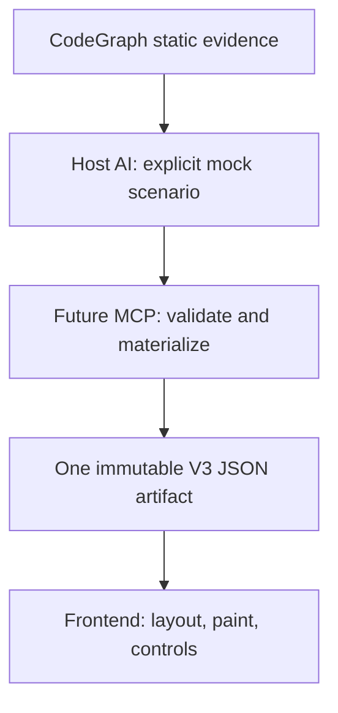

# Code Anime V3 — proposed FE-first architecture

> **Status: DESIGN PROPOSAL, NOT IMPLEMENTED OR APPROVED FOR CODING.** The owner authorized these design, architecture, implementation-plan, and GitHub-task documents only. Any FE or MCP source changes require separate V3 design approval, separate implementation-plan approval, and explicit implementation authorization. Backend implementation is **FUTURE / DEFERRED**. Do not merge, publish, tag, or deploy.
>
> **Task:** CA023. **Contract:** [flow-scene-json-contract.md](flow-scene-json-contract.md). **Backlog:** `.agent-tasks/code-anime-v3-design-20261029.md` (CA022–CA039).

## 1. Purpose, authority, and invariants

Code Anime remains a **static CodeGraph-evidence + clearly labeled host-AI mock** flow visualizer. It must not execute, import, instrument, debug, profile, or record the analyzed user's application. The requested V3 boundary is **one complete, self-contained, immutable semantic JSON document for each prepared animation**, produced by Code Anime's MCP/Node side. That document contains a required `proposed` ready variant and an optional ready or explicitly unavailable `baseline` comparison variant under `variantsById`. Every ready variant owns its independent graph, source hash, frames, source and Values; the document is not a merged graph. The desktop frontend consumes the same document for every playback step, comparison selection, orientation, resize, zoom, and visual group expansion. It must not ask the server for a new document because the viewport or selected variant changed.

The two forms of “complete” are distinct:

1. **Artifact completeness:** Every prepared node, edge, group, source snapshot, playback frame, value, Visit destination, and relevant diagnostic for each available variant is present in one document. An unavailable requested baseline includes its explicit reason. No browser continuation merging or semantic-data fetch is necessary.
2. **Analysis coverage:** CodeGraph may not expose every source path, and host-AI branches/values are simulated. The JSON **must report** `partial`, `unresolved`, or `provider-truncated` coverage honestly, even though the artifact itself is complete and valid. One JSON never proves runtime execution or exhaustive discovery.

The user's existing desktop locations, panel dimensions, control arrangement, Follow, source display/highlighting, Visits, Values, navigation, and playback semantics remain locked. Outside the chart, only darker theme tokens and compact _internal_ spacing are candidates for later authorized FE work. Graph layout may change shape, grouping, routing, and geometry without moving external components. Old-session format compatibility is not a current requirement; preserve 100% of current **new-session** source and interaction behavior at any later live cutover.

## 2. Ownership and trust-boundary diagram



| Owner                                     | Allowed responsibility                                                                                                                                                                                                                                                                               | Explicitly not allowed                                                                                                                                                                     |
| ----------------------------------------- | ---------------------------------------------------------------------------------------------------------------------------------------------------------------------------------------------------------------------------------------------------------------------------------------------------- | ------------------------------------------------------------------------------------------------------------------------------------------------------------------------------------------ |
| **CodeGraph**                             | Source definitions, call/reference/relationship evidence and bounded query receipts across supported languages.                                                                                                                                                                                      | Claiming chosen runtime branches, observed variable values, or complete coverage from a partial receipt.                                                                                   |
| **Host AI**                               | Interpret retrieved source and choose plausible mock inputs, operations, paths, values, labels, group definitions, and uncertainty with receipt references.                                                                                                                                          | Claim actual runtime observation or omit unknown behavior by inventing a confident branch.                                                                                                 |
| **MCP/Node — FUTURE**                     | Validate evidence and mock operations, canonicalize IDs, construct typed nodes/edges/groups and source/token spans, assemble continuations, precompute _all_ replay/Values/Visits/stack/console data, validate and persist one complete JSON.                                                        | Use an independent TS/JS or other language analyzer, execute target code, silently remove required events, or compute graph viewport coordinates.                                          |
| **Frontend — future authorized FE phase** | Validate incoming display contract without reconstructing business truth; select precomputed frames, seek/pause/Follow, source viewport paging, visual collapse, local orientation/zoom/pan, measure cards, compute graph geometry and orthogonal connector points, paint styling and accessibility. | Parse source for `if`/`loop`/`try`/`switch`/`lambda`, infer branch/call semantics, infer/mutate event edges or values, fold continuation chunks, or fetch viewport-specific semantic JSON. |

**Meaning of “group display”:** The backend supplies exact group IDs, kinds, parents, and member node IDs. Frontend may hide/show a supplied group, measure and surround its already declared members, or reroute an _existing_ edge around the hidden visual group. It cannot create a new semantic edge, infer a new membership, or change an edge's branch/exception meaning. Any visual proxy representing a collapsed existing connection must carry its original immutable edge ID(s); on expansion the original endpoints reappear. If group collapse cannot preserve truthful routing, show a clear incomplete route indicator instead of fabricating a transition.

**Meaning of “presentation geometry”:** JSON has no node `x/y/width/height`, edge polyline/route points, canvas viewport, ELK placement, or device-specific measurements. FE computes these from the explicitly supplied topology and local measured content. This cleanly separates language-independent meaning from display.

## 3. Planned lifecycle and immutable boundary

1. **Static evidence (current foundation):** The agent queries CodeGraph for the chosen project root/entry point, calls, definitions, references, relationships, and source. Evidence receipt IDs remain tied to exact provider outputs and queried source version. Unread or truncated CodeGraph pages remain visible as incomplete evidence.
2. **Mock authoring (current/partial foundation):** The host AI submits plausible scenario operations with explicit `certainty`, structured semantic group definitions and paths. No analyzed code executes.
3. **Canonical preparation (future):** MCP validates receipt references, group parent/call/task membership, explicit edge endpoints/outcomes, source locations, IDs, and mock values. It compiles display nodes, relationships, groups, and precomputed step snapshots. A source snapshot is for **display**, not evidence of a new internal analyzer.
4. **Continuation folding (future):** MCP alone follows each variant's validated `previousSessionId` chain, checking its own source hash, scenario, duplicate IDs, contradictory definitions, mock output across chunk boundaries, and terminal completion. Baseline/proposed must reference the same project root and target, but **may have different source hashes** (`src/services/simulation-service.ts:739–754`). The frontend receives neither `nextSessionId` nor a partial semantic chain to merge.
5. **Atomic artifact (future):** MCP validates both the required proposed variant and every requested baseline state, with all references scoped to one variant. It measures byte/memory/time budgets across the **entire serialized root and all present variants**, then persists one JSON atomically. A failed fold or invalid link yields a typed error, not a partially valid ready variant. A deliberately incomplete simulated scenario may still yield a complete **honestly flagged** ready variant.
6. **Desktop (FE-first design, later implementation):** The browser reads the document once (or an injected test fixture), locally selects an available variant, paints its exact source/value/trace content, and computes ELK adaptive geometry for both orientations. Baseline absent means the comparison selector is hidden; explicitly unavailable baseline means a disabled selector with the supplied reason. Preserve separate `cursorByVariant` and geometry caches; resizing, zooming, seeking and variant changes trigger **no further semantic data request**.

```mermaid
sequenceDiagram
  participant S as "Future MCP/Node"
  participant F as "Frontend"
  S->>F: "Complete immutable V3 JSON"
  F->>F: "Validate references; build geometry"
  F->>F: "Paint source, graph, values, frames"
  F->>F: "Resize/orient/zoom: local layout"
  F->>F: "Seek/Visit/Follow: precomputed frame"
```

The flow above describes the **target**, not the current release. FE-first work may prototype the target with synthetic versioned JSON fixtures **only after separate implementation authorization**. Fixture success is not evidence that a real CodeGraph→MCP artifact exists.

## 4. Current code versus target responsibility

| Current observed code                                                                                                 | Current responsibility                                                                                                                                                     | V3 target and task boundary                                                                                                                                                                                      |
| --------------------------------------------------------------------------------------------------------------------- | -------------------------------------------------------------------------------------------------------------------------------------------------------------------------- | ---------------------------------------------------------------------------------------------------------------------------------------------------------------------------------------------------------------- |
| `src/domain/trace.ts`                                                                                                 | Defines v2 events, optional semantic groups, source snapshots, per-chunk limits and coverage metadata.                                                                     | Keep as historical validated input; the **future** V3 output is an additional complete, explicit graph/frame contract (CA033–CA035).                                                                             |
| `src/services/animation-builder.ts`, `src/services/simulation-service.ts`, `src/storage/event-journal.ts`             | Accept simulated operations, validate CodeGraph receipts/group paths and persist continuation chunks; CA014 only partially integrated and CA021 correction still unpushed. | Future server materialization compiles complete graph and per-frame snapshots, validates bytes and ancestry without changing live code now (CA033–CA035).                                                        |
| `src/services/source-catalog.ts`                                                                                      | Captures original source text for display, with current bounded file/session budgets.                                                                                      | Preserve exact authorized source and source-mapping provenance. Reading display source is not an independent semantic analyzer; create server-owned syntax token spans in a future UI-display preparation stage. |
| `src/web/app.ts` `/api/flow/:id`                                                                                      | Returns current raw flow plus `nextSessionId` and optional baseline continuation.                                                                                          | Future read-only, versioned artifact endpoint/file; no viewport-specific regeneration (CA035).                                                                                                                   |
| `public/player.js`, `public/replay.js`                                                                                | Derive replay, Values, object histories, source Visits, Follow decisions, and fetch/merge continuations.                                                                   | **Later** replace semantic derivation with direct frame/Visit/value bindings from one artifact; keep timing/camera/selection and exact user-visible new-session behavior (CA031, blocked on deferred server).    |
| `public/semantic-flow-model.js`, `public/diagram-control-layout.js`                                                   | Current browser-side source/keyword heuristics and control-topology construction.                                                                                          | Not allowed in a compliant V3 render path; future FE only consumes server-declared nodes/edges/groups (CA028/CA031). Do not delete legacy files in this docs phase.                                              |
| `public/diagram-elk-layout.js`, `public/diagram-routing.js`, `public/diagram-label-placement.js`, `public/diagram.js` | Current browser ELK Worker, layout/route/label placement, but also graph semantic construction.                                                                            | Preserve/refine **geometry only** for adaptive width+height packing, nonoverlap, grouping separation and honest edge labels; remove semantic construction in future cutover (CA029–CA030).                       |

Existing checkpoints are not V3 completion: CA013 group schema and CA020 root/sibling geometry validation are remotely DONE; CA014 ingress and CA016 ELK wrapping are partial; CA021 fix is independently reviewed but **uncommitted/unpushed**; CA015 and CA017 are superseded plans; CA019 producer docs remain uncommitted in separate existing files. Do not conflate these with approved V3 implementation.

## 5. Source and playback parity contract

The frontend must display the **original source text** byte-for-byte in content (including original `CRLF` versus `LF`, indentation, Unicode, and a generated-source location when provided). The source viewer may virtualize long files and use the existing ±2-line focus preference while animating; the data source stays immutable. The eventual server compiler must supply syntax `tokenSpans` as display metadata so FE does not scan source. The token ranges use half-open **UTF-16 code-unit** offsets into the exact decoded text, matching browser slicing; reject out-of-range, split-surrogate or ambiguous spans instead of silently shifting highlighting. Source line numbers remain **1-based**.

The server precomputes **for each ready variant** one complete ordered frame sequence (step `1..N`, plus UI cursor `0` meaning before the first step) with stable variant-local frame/event/node IDs, active source range, full mock Values/objects/stack snapshot references, console-through index, call/task selection indexes, and ordered source-line Visit targets. Repeated Visits to the same source line in a loop or across tasks must remain **chronological 1-based numeric `playback.sourceVisits[].stepIds`** (for example, `[2, 7]`), not deduplicated or replaced by opaque `playback.frames[].id` values. The frontend may compute a current viewport window or look up a supplied Visit index for UI navigation; it must not replay assignments, decide branch outcomes, merge ANSI chunks, infer stack/value changes, or reuse baseline Values in a proposed frame. The server must normalize split ANSI terminal sequences across continuation boundaries before final console display metadata is emitted.

Existing source panel, line highlighting, Follow/unfollow, pinned invocation, Step Into/Over/Out, object details, Values, Visit prev/next, console, baseline comparison, keyboard focus, and playback timing are later **acceptance tests**, not current V3 achievements. Any behavior whose data cannot be represented is a **contract defect** to solve before live cutover. The current panel sizes and controls are not open for redesign.

## 6. Geometry and visual error boundary

The client uses explicit graph relationships to map semantic types onto shapes, colors, nested boundaries and labels; it measures displayed cards and computes local ELK routes for available canvas `{width,height}`. Horizontal orientation may wrap into several rows; vertical into several columns; small graphs should not be force-wrapped. Source order and edge meaning never change with orientation. Group containment, sibling separation, node clearance, port alignment, label boxes and orthogonal edge validity are checked **before** painting. Clarity and truthful connections take precedence over maximizing fill. Zoom/pan never substitutes for geometry validation and must not introduce an arbitrary node-count limit (finite engine/device transform bounds remain necessary).

On structurally malformed semantic JSON—missing/duplicate mandatory IDs, dangling node/source references, contradictory or cyclic group ancestry, malformed required certainty in **any declared ready variant**—**reject the entire `FlowSceneDocument` as `INVALID_ARTIFACT` before painting any variant**. A valid proposed graph does not authorize partially painting it when a ready baseline is malformed; the root is atomic. An explicitly `{availability: "unavailable", reason: "..."}` baseline, however, is a valid unavailable state and leaves the proposed scene usable with comparison disabled. This is different from **valid explicitly unresolved semantics**: a declared node/edge with stable IDs, `certainty: "unresolved"` and an evidence-gap note remains renderable as uncertain, not a broken artifact. Never turn an invalid graph into apparently valid `unresolved` nodes by guessing ownership.

Each ready variant retains the **complete immutable semantic `graph.edges[]`** regardless of group collapse. A frontend-only `visibleEdgeIds` set is a subset selected for painting: wholly internal edges of a collapsed group may disappear visually, but remain present and addressable in the model; external boundary proxies keep the original edge IDs, endpoints, certainty and direction, never a new `group → target` semantic edge. A missing _optional visual port_ may leave a valid group expanded or produce a visible routing warning, not trigger semantic repair. On otherwise valid topology with an invalid or stale layout calculation, retain the previous valid geometry for that same artifact/revision, cancel stale workers, and offer fit/retry while preserving semantic IDs; never substitute a graph with fabricated control transitions. Scene revisions and cache keys may include artifact revision, orientation, viewport size, text metrics, and visual collapse state—never semantic source parsing results.

## 7. Security, budgets, and failure semantics

- **Source privacy:** Original source and mock values may contain project-sensitive data. The future localhost endpoint must validate session/source-root ownership, refuse cross-root retrieval, disable cache/storage sharing as appropriate (`Cache-Control: no-store`), use existing CSP/text-only rendering, and treat artifact links/IDs as access-control input rather than authentication by themselves. Do not place generated JSON into the analyzed user's project.
- **Injection/data keys:** Render source/labels/values using text nodes, never untrusted `innerHTML`, script or stylesheet. JSON may contain literal filenames or mock keys such as `__proto__`; keep them as own data entries (e.g. arrays or safe `Map` keys), without prototype pollution or key loss.
- **Integrity:** Validate strict schema version, valid `comparison.defaultVariantId`/`variantOrder`, variant availability and every reference within its own ready variant before serving/painting. Never resolve an invalid proposed reference from the baseline's ID table. Persist a canonical completed artifact atomically; keep a **detached** digest or HTTP ETag over exact stored bytes (not an impossible self-hash of a field inside the same JSON). Reject incompatible versions and corrupted payloads with typed diagnostics.
- **Resource limits:** Existing `SimulationService.submit` JSON boundary is **8 MiB per submission**; existing source-snapshot caps are 512 KiB/file and 2 MiB/session, with session persistence settings separate. None is an established aggregate V3 document limit. Future server authors must measure the **combined root, proposed and baseline** serialized byte/CPU/memory costs, impose configurable budgets and cancellation, reject oversize artifacts explicitly, and preserve already validated trace state. **Never invent a measured budget or silently drop a variant to fit.**
- **Error matrix (future API proposal):** `NOT_READY` (assembly unfinished), `INVALID_ARTIFACT` (dangling/cyclic/conflicting relationships), `ARTIFACT_TOO_LARGE` (measured output budget exceeded), `SOURCE_MISMATCH` (continuation/project hash conflict), `INCOMPATIBLE_VERSION`, `EXPIRED`, and `INCOMPLETE_EVIDENCE` (explain missing or truncated provider data). These are **proposed future typed errors**, not current endpoint response guarantees. Truthful `coverage.status=partial` plus `complete:false` is valid only for an intentionally unfinished mock scenario explicitly labeled as such; invalid graph structure is never a valid partial artifact.

## 8. Phased delivery and verification ownership

| Phase                   | Deliverable                                                                                                                                                                        | Authorization and evidence                                                                                                                                         |
| ----------------------- | ---------------------------------------------------------------------------------------------------------------------------------------------------------------------------------- | ------------------------------------------------------------------------------------------------------------------------------------------------------------------ |
| **Now: docs only**      | This architecture and contract, FE graph design, future MCP security plan, implementation plan, Council decision, GitHub task ledger.                                              | Requested. Independent doc review and verified task-specific commits required. No code changes.                                                                    |
| **Later: FE-first**     | Isolated fixture-driven input adapter, adaptive layout, semantic shapes/routing, source/interaction parity design and screenshot review.                                           | **PLANNED / NOT AUTHORIZED** (CA028–CA032); fixture tests cannot certify production contract. No live source panel cutover until server can deliver complete JSON. |
| **Future: MCP backend** | CodeGraph/host-mock topology producer, server graph/frame/Visits/Values compiler, continuation fold, single JSON export, quotas/privacy/versioning and native provider smoke.      | **FUTURE / DEFERRED / NOT AUTHORIZED** (CA033–CA039); no implementation or publication today.                                                                      |
| **Final integration**   | One artifact opened once, zero browser semantic scanning/continuation fetch, source/Visit/Values exact parity, both orientation visual QA, native CodeGraph evidence as available. | BLOCKED on future backend, desktop browser/user acceptance, separate approvals and task-specific verification.                                                     |

**Outstanding human decisions:** Approve this exact V3 design package; separately approve the implementation plan after review; separately authorize FE code work when ready, and later MCP/backend code work. Council/agent agreement and a pushed design ledger never substitute for those approvals.
