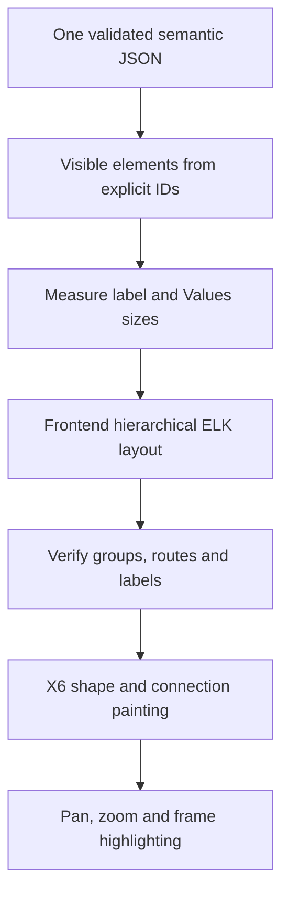
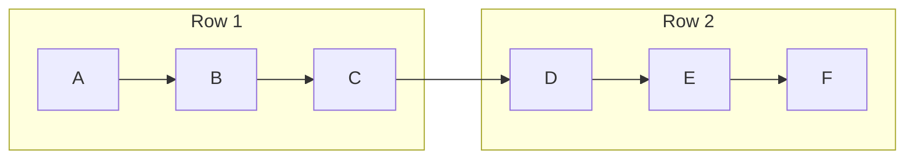
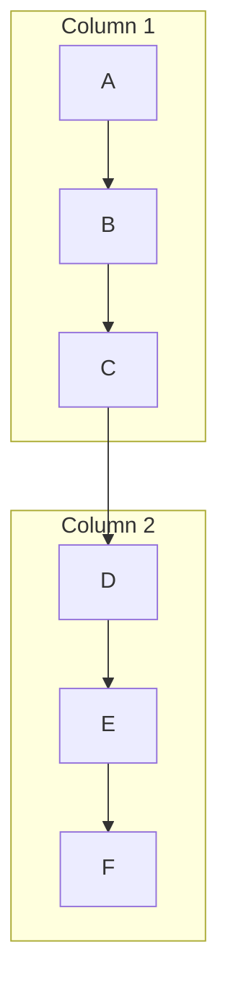

# Code Anime V3 — Frontend Graph and Geometry Design

> **Status: proposed design, not implementation approval.** 2026-10-29. This document is part of the FE-first V3 design package. The user must approve the V3 design and then its separate implementation plan before product code changes. No frontend, backend, test, CSS, control, or package change is authorized by this document.

## 1. Intent and non-negotiable boundaries

Code Anime displays one static, simulated execution scenario derived from CodeGraph evidence and host-AI mock values. The diagram should look like a clear technical flowchart: distinguish shapes, colors and nested scopes, show crisp directional connections, and distribute long flows across available _width and height_. The example diagram supplied by the user is a visual grouping reference, not a literal template or an architecture to copy.

The **MCP side supplies exactly one complete, versioned semantic JSON document** for the selected flow, including a required ready `proposed` scenario and an optional ready or unavailable `baseline` comparison. Every ready variant independently supplies stable nodes, edges, groups, source text/tokens, frame order, values and provenance. Frontend code selects one declared ready variant and performs **presentation only**: measuring labels, choosing visual shapes/colors from supplied tags, packing and routing those explicit graph elements, zooming, panning, selecting already supplied frames, and painting existing UI controls. Geometry is computed locally when the viewport or visible card dimensions change. **Viewport/orientation/variant selection never requests a new semantic JSON document.**

Frontend must never:

- scan source text or parse language syntax to detect `if`, `else`, `for`, `while`, `switch`, `case`, lambdas, `try`, `catch`, `finally`, or ownership;
- derive event order, invoke/return links, branch outcomes, iteration membership, source provenance, group hierarchy, reachability or possible paths;
- execute user code, evaluate conditions, construct mock values, append/merge continuation chunks, fabricate a missing node/edge, or infer certainty from color;
- call CodeGraph or trigger MCP reanalysis for a viewport change, collapse action, Values expansion, zoom, frame seek or orientation change.

**Source display must stay correct**: the existing source panel, exact source text and token rendering, active-line highlighting, Visit selection, Values snapshots, playback, keyboard interaction and controls retain their visible locations, sizes and behavior for newly produced V3 flows. Group/graph-only visual changes must not silently change source data or replay semantics.

Normative JSON field names, validity rules, certainty/provenance and continuation ownership belong to [V3 flow-scene JSON contract](flow-scene-json-contract.md). The names below are _illustrative consumers_ of that contract, not a second competing schema. This document specifies only rendering and geometry invariants.

**Comparison selection is local presentation, not a semantic diff.** The supplied `comparison.defaultVariantId` selects the first ready variant. `comparison.variantOrder` controls the existing baseline/proposed selector; an absent baseline hides comparison, and an explicitly unavailable baseline disables its choice with its server-provided reason. The client keeps `cursorByVariant` and render/zoom/collapse state independently, reuses only that variant's graph/source/Values/Visits/console, and never pairs nodes or frames across variants by matching labels, IDs or source lines. Each variant can have a different source hash even for the same project and target.

## 2. What stays exactly where it is

The current desktop application is the layout boundary. **Do not move, resize, reorder, replace or remove** the top bar, source walkthrough, graph viewport, execution/console strip, playback bar, icons-only graph controls, orientation toggle, Fit/zoom/pan buttons, Visit/Values controls, or any other current component. Maintain current interactions, ARIA/keyboard support and panel split; do not add responsive/mobile restructuring.

Allowed outside the graph: _darker theme tokens_ and _smaller internal padding/margins_ where content remains readable and focus targets remain operable. Do not reclaim space by collapsing/moving panels, suppressing data, changing default source line windows, removing controls or changing behavior. The existing chart is the only major layout redesign target.

Canvas width/height and graph pan/zoom are already user-controlled. Filling unused canvas space is a **graph packing and readability** objective, not a mandate to fill every pixel. A small graph stays compact; forced extra rows/columns would make it less clear.

## 3. Contract-to-presentation boundary

| Server-supplied semantic field (contract owns names)                                     | Permitted frontend use                                                                     | Forbidden frontend inference                                                                   |
| ---------------------------------------------------------------------------------------- | ------------------------------------------------------------------------------------------ | ---------------------------------------------------------------------------------------------- |
| `graph.nodes[]` with IDs, display labels, semantic tags and optional source anchors      | Measure text, size and draw each card; choose a documented shape/style for an explicit tag | Guess kind, branch, function or source range from label/source text                            |
| `graph.groups[]` with IDs, parent IDs and direct membership                              | Place bounded nested region boxes; label and collapse exactly the declared members         | Reconstruct region hierarchy from indentation, line numbers or graph proximity                 |
| `graph.edges[]` with stable `id`, `fromNodeId`, `toNodeId`, `kind`, `certainty`, `label` | Route the supplied directed relation; style explicit certainty; reserve ports and labels   | Connect consecutive nodes by screen position, join branches, add call/return or loopback edges |
| `playback.frames[]`, `playback.initial`, `playback.navigationByCursor[]`                 | Select the supplied cursor state, active nodes/edges and prepared step targets             | Deduce executed branches, fake visit counters or change graph membership                       |
| Server-provided source files, `text` and token spans                                     | Display exact text and active region; preserve current source behavior                     | Run lexical source scanner/highlighter to synthesize tokens or ownership                       |
| Server-provided Values/Visits and navigation targets                                     | Expand already supplied value cards, select prepared visits/frames                         | Recompute locals, evaluate conditions or invent missing visit frames                           |

**Structural invalidity is not semantic uncertainty.** Duplicate/missing mandatory node, edge, group or frame IDs; dangling endpoints or source/token references; cyclic/missing required group ancestry; and malformed required certainty fields are **`INVALID_ARTIFACT`**. **Reject the entire `FlowSceneDocument` as `INVALID_ARTIFACT` before painting any variant** when _any declared `availability: "ready"` variant_ is structurally malformed; never paint the valid proposed graph while ignoring a malformed ready baseline. Do not offer an `unresolved` fallback derived from damaged relationships. A baseline explicitly declared `{availability: "unavailable", reason: "..."}` is different: preserve the valid proposed scene and disable its baseline selector with that reason. An explicitly declared, structurally valid node/edge with `certainty: "unresolved"`, a permitted `sourceRef: null`, and its evidence-gap note **is valid semantic uncertainty** and remains visibly neutral/dashed. Missing optional _visual-only_ port or label-placement hints may instead produce a presentation warning without changing the valid semantic model.

### Rendering stages

Only the first box is the MCP/backend output. All other stages are local presentation transforms. A failed geometry stage must **not** mutate or reinterpret the supplied semantic JSON.

## 4. Two-dimensional, orientation-led packing

The user selects a **preferred flow direction**, not a one-row/one-column limit:

| User orientation    | Preferred local order                 | Adaptive use of spare dimension                                                                                          |
| ------------------- | ------------------------------------- | ------------------------------------------------------------------------------------------------------------------------ |
| Horizontal          | Left to right within a lane           | When graph breadth justifies it, create **multiple rows**, preserving explicit directed edges through orthogonal routes  |
| Vertical            | Top to bottom within a lane           | When graph depth justifies it, create **multiple columns**, preserving explicit directed edges through orthogonal routes |
| Either, small graph | One tidy row or column as appropriate | Do not force wrapping merely because empty canvas exists                                                                 |

Conceptual **horizontal** layout of one supplied six-step sequence, using two left-to-right rows instead of one very long row:

Conceptual **vertical** layout of the same supplied sequence, using two top-to-bottom columns instead of one very tall column:

The lettered nodes and edges are **illustrations of geometry, not license to generate a sequence**. An actual canvas draws only the explicit IDs and edges present in its semantic JSON. Complex branch/call/exception topology may occupy different rows and columns to protect clean grouping.

Measure both the graph viewport's available **width and height** (not width alone). Include current title text, font metrics, group headers, expanded Values card dimensions, edge-label reserves and a small outer safety inset. Feed the aspect ratio plus explicit hierarchy to a hierarchical ELK layout in a Web Worker, using `RIGHT`/`DOWN`, layered routing and controlled wrapping. The existing `elkjs` dependency and geometry utilities are the starting point; do not add a new graph-layout dependency without a later reviewed need.

Packing objectives, in priority order:

1. Preserve **semantic relationships exactly as supplied**: stable IDs, source→target direction, branch/return/exception certainty and declared parent groups.
2. Preserve **clarity**: no overlapping sibling node interiors, nested group containment, visible labels, usable group gutters and edge direction cues.
3. Minimize unnecessary crossings, bends, long inter-group detours and orphaned labels, particularly between distinct branch arms.
4. Achieve balanced use of available width/height and reduce unnecessary empty bands **only after** the above constraints pass.

A better fill ratio never justifies an illegible, overlapping or misleading flow. Content dimensions may exceed the viewport when dense grouping demands it; existing pan/Fit/zoom navigates the result. Do not shrink node text until unreadable to fit a target occupancy percentage. Responsive graph _packing inside the fixed desktop panel_ is allowed; responsive app/panel rearrangement is not.

### Group-aware constraints

- Distinguish **file/owner/invocation** containers from **control** regions (`loop`, decision arm, `try`/`catch`/`finally`, and other server-supplied tags); retain declared nesting at every zoom.
- Reserve clear label gutters inside a group. Keep label text separate from child cards, return edges and crossing segments. Nested groups have distinct header bands and visible spacing.
- Prefer to keep a small control group intact. If a long group needs internal wrapping, wrap _its own declared children_ without changing the group boundary or semantic order; never scatter members across unrelated file or invocation groups.
- Route crossing inter-group edges through reserved exits/ports. Do not let a line appear to enter an unrelated group as though the group owned that edge.
- Determinism: identical immutable JSON, visible-state selection, font metrics, viewport dimensions and orientation produce the same coordinates, edge IDs, ports and group placement.
- Do not allocate arbitrary per-node caps; use bounded computation, cancellation and error reporting instead. A 500-node diagram may legitimately overflow the view while preserving readability.

## 5. Semantic tags map to visual grammar only

Each supplied type has a consistent visual treatment. This is a **style map**, not a language grammar or proof of execution:

| Explicit server tag                      | Proposed visual                                           | Purpose                                                  |
| ---------------------------------------- | --------------------------------------------------------- | -------------------------------------------------------- |
| Ordinary operation/call                  | Compact rounded rectangle; call marker/left accent        | Readable default, active step can highlight              |
| Decision / `if` / `switch` dispatch      | Visually distinct diamond/decision card with upright text | Recognizable branching point, without inventing outcomes |
| Loop/iteration region                    | Rounded blue group rail with clearly labeled loop header  | Repeated visit grouping, not an implicit loopback edge   |
| Branch/case/else arm                     | Indented nested amber-outline region; labels from JSON    | Separation of mutually exclusive or alternate paths      |
| Try/catch/finally/recovery region        | Teal region with distinct narrow accent stripe            | Recovery scope without guessing exception paths          |
| Return                                   | Rounded pill/terminal card in violet                      | Terminates only when the supplied edge/frame says so     |
| Throw/error                              | Rose narrow-accent card                                   | Error state, not proof a handler catches it              |
| Lambda/callback/other language construct | Neutral invocation/group styling from supplied tag        | Cross-language, without TS/JS assumptions                |
| Unresolved/uncertain membership          | Neutral dashed edge/border with visible uncertainty text  | Never pass uncertainty off as an observed branch         |

Do not use color as the sole signal. Shape, label, border style and ARIA name must convey the same distinction; no tooltip-only meaning. Preserve existing `title`/source line/Values display and source-seeking affordances. Long labels wrap inside measured cards; do not simply clip branch labels so two different cases look identical.

### Dark color direction, proposed tokens

These are **design candidates**, not measured contrast results or permission to edit existing styles:

| Element          | Candidate color | Meaning                                     |
| ---------------- | --------------- | ------------------------------------------- |
| Graph canvas     | `#0A1322`       | Near-black blue base, quiet grid texture    |
| Card             | `#17253C`       | Distinct from canvas                        |
| Region border    | `#38516B`       | Clear separators without heavy visual noise |
| Foreground       | `#E7F1FF`       | High contrast readable text                 |
| Muted text       | `#AFC4D9`       | Labels/metadata                             |
| Active execution | `#6ED8FF`       | Current selected frame                      |
| Loop             | `#55B4FF`       | Structural repetition                       |
| Decision/case    | `#FF965B`       | Branching                                   |
| Recovery         | `#40D9AA`       | Try/catch/finally                           |
| Return           | `#B59AFF`       | Terminal result                             |
| Throw            | `#FF859D`       | Exceptional state                           |

Current `public/diagram.css` already defines a related palette; prefer token refinement within the existing dark theme, not a second CSS system. Before any eventual implementation, check actual rendered WCAG contrast (normal text target **4.5:1**, prominent shape/interactive boundaries target **3:1** when applicable), keyboard focus, line contrast and reduced-motion behavior on the user's desktop. These contrast targets are **future acceptance goals**, not verified claims.

## 6. Connections, ports and labels

The JSON edge is authoritative. For each provided edge:

1. Retain `id`, original `fromNodeId`, `toNodeId`, `kind`, `certainty` and original label through all layout passes.
2. Select a visible presentation port on the source and target shapes, honoring nested group exits and direction. A branch/catch/call/return style does **not** create an edge by itself.
3. Use orthogonal segments, with arrowheads and reserved lanes. Avoid card interiors, group titles, sibling label boxes and overlapping same-direction segments when geometry permits.
4. Place a supplied label in an actual free reservation. If no collision-free label box exists, keep the edge's semantic label in accessible inspection/ARIA and visibly disclose its unavailable placement; never silently replace a label or fake a bend.
5. Honor explicit edge certainty/status: selected prepared path prominent, possible/unselected alternative distinguishable, unresolved dashed/neutral. **`activeEdgeIds` only selects existing IDs for visual emphasis**; absence from the current frame is not proof of impossible reachability.
6. Preserve reciprocal and parallel distinct IDs even when they share endpoints. A route failure stays an explicit warning; it cannot become a straight-through fabricated connection.

Edges between separate groups should connect through their correct boundary ports with clean crossings. File/invocation/control containers cannot implicitly connect just because the user places them adjacent on screen.

### Collapse and hidden-endpoint proxy (EDO challenge #1)

Suppose group `G` contains nodes `X` and `Y`, while a supplied edge `eXZ` goes from `X` to visible node `Z` outside `G`. When `G` is collapsed:

- The frontend may move **only the painted source anchor** for `eXZ` from hidden `X` to the visible boundary of `G`. It must retain `eXZ`, original `X → Z`, direction, certainty, label, frame highlights and accessible identity. It does **not** produce a semantic `G → Z` edge.
- The label/inspector should expose that the visible group boundary represents a **hidden `X` endpoint**. Multiple distinct outgoing edges from `X` and `Y` remain distinct, even if both visually start at `G`.
- If both ends of a provided edge are hidden within the same collapsed group, omit that edge from **visible painting only**, rather than fabricate a group self-loop. The immutable model still owns its original edge ID and both endpoints; expansion restores their visible representation.
- Use **only explicit parent/member relationships** and optionally supplied presentational collapsed-port hints to choose the nearest visible group. Do not compute a new bypass path, group-level reachability, or branch outcome.
- At UI cursor `0`, show `selectedVariant.playback.initial`; at cursor `1..N`, read `selectedVariant.playback.frames[cursor - 1].activeEdgeIds` to emphasize supplied edge IDs. Visit targets are the 1-based `selectedVariant.playback.sourceVisits[].stepIds`, and controls use `selectedVariant.playback.navigationByCursor[cursor]` without inference. The client does not calculate execution visibility from source locations or branch values.

**Negative fixture:** `G` contains decision `X`, true-arm `Y`, false-arm `W`; `Z` is outside. The JSON declares edges `eXY`, `eYZ` (prepared) and `eXW`, `eWZ` (possible). On collapse, internal `eXY` and `eXW` may disappear **only from the painted subset**, while `eYZ` and `eWZ` retain separate IDs, semantic endpoints and certainty even if their rendered starts share the `G` boundary. No new `G→Z` or `Y→W` edge may appear. Visit selection changes only explicit highlights, never synthesized connectivity. If _mandatory_ group ancestry/edge identity/certainty fields are absent, reject `INVALID_ARTIFACT`; if only an _optional presentation_ collapse-port hint is unavailable, leave the valid group expanded or show a visual-routing warning instead of guessing.

## 7. Local interaction and geometry lifecycle

The initial semantic JSON arrives once. The frontend retains it **immutable**; presentation state can include selected ready variant, orientation, zoom/pan, focused frame, expanded groups, selected Visit, and open Values sections. These states are keyed by variant where content differs. This state must not become a second semantic trace.

| User action              | Local work permitted                                                                                                                                  | Explicitly prohibited                                                                               |
| ------------------------ | ----------------------------------------------------------------------------------------------------------------------------------------------------- | --------------------------------------------------------------------------------------------------- |
| Orientation toggle       | Repack explicit graph elements rightward/downward; relayout arrows                                                                                    | New MCP/CodeGraph fetch; re-order supplied frames                                                   |
| Canvas resize            | Debounced width+height re-layout using same JSON                                                                                                      | Ask server for viewport-specific JSON                                                               |
| Values expand/collapse   | Measure card size and re-layout affected region/edges                                                                                                 | Recompute or truncate snapshot values                                                               |
| Collapse/expand group    | Change visibility and geometric proxy anchors only                                                                                                    | Add semantic group/node/edge or bypass                                                              |
| Seek/Play/Pause/Visit    | Select supplied frame and visual highlights                                                                                                           | Infer next event, branches, source tokens or merge continuations                                    |
| Baseline/proposed switch | Select another available `variantsById` entry; restore its own cursor and Values/Visits/source snapshot; show declared unavailable reason if disabled | Fetch another JSON, merge variant graphs, reuse another variant's frame references, or infer a diff |
| Zoom/pan/Fit             | Apply camera transform to already-laid-out scene                                                                                                      | Change semantic IDs, source text or routing meanings                                                |

Maintain cache key `(documentRevision, variantId, variantArtifactRevision, declaredGraphIdentity, selectedVisibleGroups, selectedVisit, orientation, viewportWidth, viewportHeight, measuredValueSizes, fontMetricsRevision)` or an equivalent stable signature. A cursor-only frame change changes **highlighting only**, unless a predeclared visible Values/card expansion size changes. Queue local Worker layout sequentially or in safely bounded parallel; cancel stale work and reject replies from another variant or earlier document, viewport, group, or layout revisions. Do not partially paint two independent variants as one current scene: commit coherent geometry after its required parts validate. Fit should target a completed scene, and user pan/zoom must supersede pending automatic Fit.

**Zoom:** No arbitrary cap based on node count, group depth or graph dimensions. A numerically infinite zoom level is impossible; use finite, engine-safe camera scales and coordinate limits with graceful saturation/disclosure. Zoom changes the camera, never repairs geometry, removes labels or changes group/branch semantics. Retain existing control locations and keyboard mapping unless a separately approved future change explicitly addresses zoom limits.

## 8. Geometry validation, failures and honest fallback

Every generated scene must pass, at minimum:

- validate the immutable semantic model first: all required declared IDs/references valid, no duplicate/dangling/cyclic ownership, then every expected **painted** visible node/group appears exactly once;
- preserve the full `graph.edges[]` model unchanged across collapse and Visit changes; `visibleEdgeIds` is only a **presentation subset** of original model edge IDs (wholly internal collapsed routes may be omitted), and every visible proxy retains its original source/target IDs, certainty and edge identity;
- every non-root child rectangle is contained in its declared parent group and in the scene root bounds;
- nonzero-area sibling nodes/regions have no overlapping interiors (touching borders allowed); nested children may overlap their _parent_ by design;
- edge sections are finite, connected and axis-aligned where orthogonal routing is required, with valid source/target IDs and correct arrow direction;
- node labels, reserved edge labels, group headers and expanded Values avoid obstructing each other, with explicit label-unavailable handling;
- no stale Worker reply, changed viewport, changed group selection or older trace revision can overwrite the latest requested geometry;
- no edge is added as a “helpful” continuation when ELK/layout/routing fails.

Apply the already developed fast sibling-overlap/root-containment validation concepts in `public/diagram-elk-layout.js`. Geometry retries and stale layout handling apply **only after an artifact has passed structural validation**. A safe fallback may retry a more conservative presentation strategy **using the same supplied topology**, with explicit status. If valid geometry still cannot be found, keep a last _clearly marked stale_ diagram or show an error/semantic event list. Never display stale geometry as if it represents the new JSON. Do not silently force all complex flows into one row/column or invent a route. There is no node-count-based bailout.

## 9. Known existing code and migration boundary

| Existing location                                                   | Verified current role                                                         | FE-first future direction; **not performed**                                                                           |
| ------------------------------------------------------------------- | ----------------------------------------------------------------------------- | ---------------------------------------------------------------------------------------------------------------------- |
| `public/semantic-flow-model.js`                                     | Scans source/braces to infer structures and membership                        | Remove semantic inference from browser once MCP JSON supplies all required structure                                   |
| `public/diagram-control-layout.js`                                  | Synthesizes control regions/cards/branch relationships from semantic tree     | Replace with a **geometry-only** adapter from explicit JSON graph/visit metadata                                       |
| `public/diagram-elk-layout.js`                                      | Worker ELK packing, flattening, overlap/root validation                       | Retain/adapt as client geometry engine, feed 2D viewport and explicit groups/edges                                     |
| `public/diagram-routing.js` and `public/diagram-label-placement.js` | Local obstacle-aware routes/label reservations                                | Retain only pure geometry roles; never add semantic edges                                                              |
| `public/diagram.js`                                                 | Mixed model creation, Dagre/ELK layout, X6 shape painting, camera/interaction | Separate immutable semantic input from visual projection; keep existing external UI/camera controls                    |
| `public/player.js` and source display                               | Existing replay, source and Values interactions                               | Preserve source display/playback while removing browser semantic/continuation assembly when future backend JSON exists |
| `public/diagram.css`                                                | Current chart palette and visual grammar                                      | Refine dark tokens/group/card spacing within already approved graph visual scope                                       |

Existing CA016 adaptive viewport code and CA020 collision validation are valuable **partial/verified foundations**, not an already completed V3 graph implementation. CA015 and CA017 earlier task designs are superseded by this FE-first boundary. CA014 remains partial, CA021 reviewed-but-unpushed, and CA019 guidance edits paused; do not reclassify them as V3 DONE. The task ledger and implementation plan own migration ordering and rollback/deprecation gates.

## 10. Acceptance matrix for future implementation

This is a **planned verification matrix**. No new V3 test, native CodeGraph scenario or desktop browser/screenshot check has been run by writing this design.

| Scenario / fixture                                                              | Expected future evidence                                                                                                                                 |
| ------------------------------------------------------------------------------- | -------------------------------------------------------------------------------------------------------------------------------------------------------- |
| Small 3–5-node flow                                                             | No forced multi-row/multi-column wrapping; readable shape labels                                                                                         |
| Long 28-node flow                                                               | Horizontal uses extra rows and vertical uses extra columns as viewport aspect demands; complete exact IDs                                                |
| Nested 2–4-level groups; loop + decision + try/catch/finally                    | Containment, group gutters, no sibling overlap, correct provided edge status and arrowheads                                                              |
| `switch` cases, lambdas, callbacks and language-neutral unknown constructs      | Same schema rendering with explicit tags; zero TS/JS source parsing                                                                                      |
| Landscape 1920×1080 and narrower 800×600 desktop viewport                       | Both dimensions influence balanced packing; panel locations unchanged                                                                                    |
| Long source symbols and multilingual/unicode labels                             | Measured text fits or visibly wraps; labels do not collide with card/region titles                                                                       |
| Expand Values and change Visit                                                  | Correct frame-provided values/IDs; relayout only when dimensions/visible groups change                                                                   |
| Valid explicit `certainty: "unresolved"` node/edge with required IDs and note   | Neutral uncertainty display, unchanged references; **not** `INVALID_ARTIFACT`                                                                            |
| Missing endpoint, duplicate mandatory ID or cyclic group parent                 | Reject `INVALID_ARTIFACT` before graph painting; **not** a valid unresolved fallback                                                                     |
| Collapse `G` with wholly internal `eXY` and parallel external edges to `Z`      | Immutable model still has `eXY`/`eYZ`/`eWZ`; painted subset may omit `eXY`, but external original IDs, statuses and endpoints survive; no new `G→Z` edge |
| Async orientation/resize/Values changes before Worker reply                     | Stale geometry rejected, latest complete scene painted, user pan/zoom respected                                                                          |
| Valid JSON with overlapping rectangles or disconnected visual route             | Geometry-only failure/retry; preserve semantic document and report visibly; never claim current on stale scene                                           |
| Source frame highlight/Visits/Values/playback regression                        | Exact source text and server-provided tokens highlighted; old panel controls and behavior preserved for V3 flows                                         |
| High-count stress fixtures                                                      | Measure runtime/memory and readability; no arbitrary event cap or false PASS merely from zoom                                                            |
| Desktop screenshots of both orientations, collapsed groups, zoom and dark theme | **Human review required** for visual cleanliness; node tests alone insufficient                                                                          |

Use existing focused tests as reference: `tests/diagram-elk-layout.test.mjs`, `tests/diagram-routing.test.mjs`, `tests/diagram-label-placement.test.mjs`, `tests/diagram-control-layout.test.mjs`. Future tests must prove no invented semantic IDs/edges and cover both width and height. Synthetic fixtures test presentation contracts only; they are **not** a successful live CodeGraph→MCP integration. Real native CodeGraph and desktop browser visual checks remain separately blocked/unverified until their environments exist.

## 11. Open design decisions and explicit non-goals

- **Contract finalization:** V3 JSON contract must define immutable provenance, complete source tokens, visits and all edge/group identities; missing mandatory evidence cannot be patched by browser heuristics. Final field names come from the contract document.
- **Overflow/zoom numeric bounds:** quantify safe supported scales and coordinate extents during implementation using actual X6/browser measurements; do not claim literal mathematical infinity.
- **Label collision preference:** if no readable path can place a label, prefer accessible explicit omission and visible diagnostic over overlapping words or reassigning the edge.
- **Grouping on small displays:** app remains desktop-only; graph may overflow and use pan, but no panel movement or responsive redesign.
- **No runtime recorder/debugger:** this is CodeGraph-backed simulated flow, not executed truth. Uncertain source ownership and AI mock choices must remain visible.
- **Backend FUTURE:** contract validation, CodeGraph ingestion, complete JSON compilation, continuation finalization and migrations are future backend tasks, not FE implementation or design-delivery completion.

**Exit gate:** CA024 design can be considered document-reviewed after cross-document consistency, independent advisor review and a remotely verified task-specific documentation commit. It cannot be marked as frontend implementation DONE. BA must present V3 design and separate implementation plan for later user approvals. No merge, publish or deployment is within this task.
