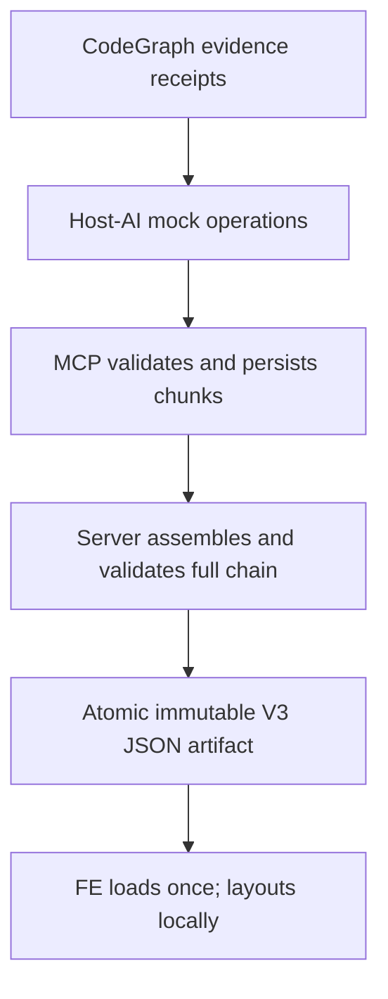

# Code Anime V3 — Future MCP Semantic Bundle Architecture

> **Status: PROPOSED DESIGN ONLY · Backend implementation FUTURE / DEFERRED.**
>
> This document defines the eventual backend responsibilities and their verification gates. It does **not** approve or implement new MCP behavior, migrate existing sessions, or certify native CodeGraph integration. The authorized near-term work is **frontend-first, fixture-driven design**. The user must separately approve the V3 design and implementation plan before production code changes.

## 1. Contract and ownership

One Code Anime player session consumes **one complete, immutable, versioned JSON artifact**. Its root `comparison` and `variantsById` envelope contains a required `proposed` ready variant and an optional independently ready or explicitly unavailable `baseline` variant. Every ready variant has its **own** graph, source hash/snapshots, frames, Values, Visits and console; the MCP server, not the browser, owns every semantic fact in that file. There is no per-viewport or per-variant API call and no frontend continuation merging or inferred cross-variant graph.

| Responsibility                                                                    | Future MCP/server                                                                                                                                | Frontend                                                                                                        |
| --------------------------------------------------------------------------------- | ------------------------------------------------------------------------------------------------------------------------------------------------ | --------------------------------------------------------------------------------------------------------------- |
| Evidence, source relationships, callable definitions                              | Retrieve and cite **CodeGraph** responses; reject missing or mismatched receipts                                                                 | Display provenance/uncertainty provided by JSON                                                                 |
| Simulated branches, calls, loops, switch/case, lambda, try/catch, values, effects | Accept **host-AI-authored mock data**, assign canonical identities, validate semantic references and label certainty                             | Never infer these from raw source or graph geometry                                                             |
| Semantic graph                                                                    | Supply complete nodes, typed edges, nested groups, labels, memberships and execution/order links                                                 | Position supplied nodes/groups, route connectors, paint shapes/labels, zoom/pan                                 |
| Timeline and inspection                                                           | Supply ordered playback frames, navigation targets, visits, value/object/stack snapshots, server-normalized plain console text and source ranges | Display the supplied frame and handle user controls; no value replay/reconstruction                             |
| Sources                                                                           | Supply exact authorized source text, file identity, line ranges, provenance and any approved display-token spans                                 | Render source and highlight provided ranges, without scanning code for semantics                                |
| Chunking                                                                          | Validate, deduplicate and assemble all persisted continuations **before publishing** the complete artifact                                       | Load the single artifact once; no `nextSessionId` traversals                                                    |
| Layout responsiveness                                                             | Supply only semantic structure and presentation hints, independent of viewport                                                                   | Compute deterministic adaptive layouts for horizontal/vertical orientation using current available width/height |

**Hard boundary:** Code Anime is a static-analysis plus labeled AI-mock visualizer. Neither backend nor frontend may execute, import, instrument, profile, or debug the analyzed project. Built-in language-specific semantic parsing is not a fallback for CodeGraph; unsupported or ambiguous constructs remain explicitly unresolved. The backend's canonicalization of already supplied event/group identities is _not_ new source-language analysis.

## 2. Current evidence and migration gap

All statements in this section are **OBSERVED in the current repository**, not V3 implementation claims.

- `src/mcp/server.ts` exposes `read_codegraph_evidence`, `build_mock_animation` (`begin`/`append`/`finish`) and a one-shot compatibility path. The builder accepts host-AI operations with `groupDefinitions` and `groupPath`; the server assigns event/call IDs. A CodeGraph receipt proves evidence retrieval, **not** that a simulated branch actually executed.
- `src/domain/trace.ts` defines V2 trace events, source locations, values, semantic group kinds (`decision`, `branch`, `loop`, `iteration`, `try`, `catch`, `finally`, `switch`, `case`, `lambda`, `sequence`, `unresolved`), nesting and certainty. `semanticGroups.memberEventIds` are **direct, chunk-local** members, not an inherited subtree membership list.
- `src/services/simulation-service.ts` checks project identity, receipt provenance, source consistency and continuation ancestry. It rejects changed semantic group definitions and contradictory source snapshots. It currently persists **separate trace chunks**.
- `src/web/app.ts` currently serves a raw flow and optional `nextSessionId` from `/api/flow/:id`. Browser code currently loads continuations and derives some semantic/playback data; these are **V3 migration targets**, not evidence that a complete bundle already exists.
- `src/services/source-catalog.ts` captures exact on-disk text for **display** inside the project boundary, with exclusions and size checks. A permitted source snapshot read must never be represented as CodeGraph proof of a relationship or branch.
- `src/services/simulation-service.ts` currently rejects submitted JSON chunks above **8 MiB**; `src/config.ts` sets a **10 MiB per-session** storage limit. Source snapshot budgets in `src/services/source-catalog.ts` are **512 KiB per file** and **2 MiB total**. None of these limits establishes the size, latency, or safe memory budget for an aggregated V3 artifact.
- `src/storage/file-session-store.ts` already uses private, atomic session files and source snapshots. Its existing per-session quotas and lifecycle do **not** yet guarantee atomic all-continuations V3 export.
- `src/index.ts` binds the existing HTTP player to `127.0.0.1`; `src/web/app.ts` sets `no-store`, `nosniff`, and a restrictive Content Security Policy. A future artifact route must retain and review these properties rather than assume localhost alone is an authentication boundary.

Related pending work is **not** silently reclassified: CA014 is a verified but **PARTIAL** server mock-metadata task; CA021 is a reviewed payload-safety fix with **local uncommitted** source/test changes, not a pushed completion; CA016 contains earlier frontend adaptive geometry but still awaits independent browser visuals; CA020 geometry validation is verified/pushed. CA019 earlier draft instructions remain uncommitted and untouched by V3. The V3 plan must explicitly reconcile and re-review these tasks before modifying their files.

## 3. Proposed complete semantic JSON

The separate [flow-scene JSON contract](./flow-scene-json-contract.md) owns the precise V3 field-level schema and fixtures. The backend must eventually output a single object with root `schemaVersion`, `comparison:{defaultVariantId,variantOrder}`, and `variantsById:{proposed:ReadyVariant,baseline?:ReadyVariant|UnavailableVariant}`. A `ReadyVariant` has `availability:"ready"`; an unavailable baseline has `availability:"unavailable"` and a non-empty reason, with no graph to invent. The following logical sections belong **inside each ready variant**, not at the root or in a merged cross-variant graph:

| Section                                 | Authoritative contents                                                                                                                                     | Guardrails                                                                                                  |
| --------------------------------------- | ---------------------------------------------------------------------------------------------------------------------------------------------------------- | ----------------------------------------------------------------------------------------------------------- |
| `artifact`, `scenario`                  | Variant-specific artifact/trace revision, source hash, project root, target, simulated input, generated timestamp                                          | Never silently coerce old V2 trace shapes or reuse proposed source hash for a baseline whose source changed |
| `provenance`, `coverage`, `diagnostics` | CodeGraph receipt IDs and retrieval/coverage boundaries; host-AI mock/assumption/unresolved flags                                                          | Receipts are not execution proof; a partial scenario may be valid but cannot claim complete coverage        |
| `nodes`                                 | Stable semantic node IDs, kind, labels, event/call/task references, semantic shape/color role, direct group affiliation                                    | No inferred syntax keywords or guessed edges in the browser                                                 |
| `edges`                                 | Explicit directed source/target node IDs, semantic edge kind, branch/return/exception/loop identity, labels                                                | Validate endpoints and ownership; FE calculates **only** connector coordinates/routes                       |
| `groups`                                | Unique IDs, kind, parent chain, direct members, arm/iteration identities, certainty, source/evidence links                                                 | Parent DAG, legal arm ownership, no sibling branch duplicate direct members                                 |
| `frames`, `navigation`                  | Full ordered playback cursor, visit IDs, active node/edge/group, source selection, snapshot references and precomputed next/previous/Into/Over/Out targets | FE never reconstructs stack/value transitions or re-evaluates branch outcomes                               |
| `sources`                               | Exact UTF-8 text, stable file keys, line/offset model, source provenance, display token spans if available                                                 | Preserve original text and current source highlighting interactions; no client source scanner               |
| `snapshots`, `console`                  | Mock values/objects/stack/log data, alias identity, precomputed plain-text output with terminal control sequences removed, and state deltas or snapshots   | Object graphs must be bounded and safe to render as text, never HTML                                        |

**CA042/CA046 navigation contract:** Within each **ready variant's** `playback`, the future server materializes `navigationByCursor` with one entry for every UI cursor `0..N`, where `N = playback.frames.length` and cursor `0` denotes before-first. Every entry supplies `cursor` plus integer-or-`null` targets `previousCursor`, `nextCursor`, `intoCursor`, `overCursor`, `outCursor`. The five targets are **precomputed server-side**, including interleaved async siblings and exception unwinds; the FE only chooses the supplied destination. Frame IDs are opaque and separate from the numeric cursor. Distinct variants have independent lookup arrays; no baseline/proposed semantic navigation merge. For attributed calls with no qualifying future event, Into/Over/Out **seek cursor `N`** even when no explicit return exists; this is a navigation fallback, not a fabricated return. Cursor `0` has Into/Over target `1` if frames exist and Out `null`; at cursor `N` all forward actions are `null`. A console event lacking invocation ownership advances on Out, while other unattributed events leave Out disabled. The normative contract defines all target bounds and attribution rules; preserve incomplete-coverage diagnostics instead of pretending the invocation completed.

**Canonical identity is the server's job.** Host AI may propose graph nodes, edge types, call/arm/group keys, iteration identity and mock values grounded in cited CodeGraph outputs. Server must bind those proposals to canonical, stable IDs **within their variant**, validate all internal references, and reject cross-variant pointers or contradictions rather than silently repairing simulated truth. A ready baseline and proposed variant must share project root and target identity, but their `sourceHash` values may differ; `src/services/simulation-service.ts:739–754` does not require matching hashes between them. If a source construct cannot be represented with evidence and a sensible mock, mark the corresponding group/edge/step as `unresolved` with a diagnostic. The frontend must not invent a branch or language rule to make the picture attractive.

**Presentation hints are not geometry.** Node shape roles, group kinds, labels, edge semantics and theme token names are data in the JSON. Actual `x/y`, bounds, grouping boxes, adaptive wrapping, connector bend points, label placement and zoom transform belong to FE. Moving between viewport sizes or changing orientation repositions the **same IDs and semantics locally**, without fetching another artifact.

### 3.1 Language-neutral producer examples (conceptual, not an existing MCP wire format)

In each case the host AI reads CodeGraph source/relationship receipts, **proposes** a mock path, and identifies the event/group/arm/call relationships. The future server canonicalizes those proposals; the browser receives no raw expression to reinterpret.

| Source construct (any CodeGraph-supported language) | Proposed host mock structure                                                                                   | Mandatory server check and unresolved behavior                                                                                  |
| --------------------------------------------------- | -------------------------------------------------------------------------------------------------------------- | ------------------------------------------------------------------------------------------------------------------------------- |
| `if/else` or ternary decision                       | `decision` group containing distinct `branch` arms, explicit branch-edge labels and selected mock event visits | Group arms do not share direct members; absent predicate truth stays `assumed` or `unresolved`                                  |
| `for`/`while`/iterator loop                         | `loop` parent with indexed `iteration` child groups and explicit loop-back/exit edges                          | Preserve iteration IDs/order, distinguish repeated visits from duplicate semantic nodes; do not assert observed iteration count |
| `try/catch/finally`                                 | `try`, selected `catch`, optional `finally`, and typed throw/handler/finalization edges                        | Match call/stack ownership and unwind targets; an unmodeled exception route stays `unresolved`                                  |
| `switch/case` or pattern selection                  | `switch` parent, distinct `case` arm IDs and explicitly labeled selected/default edges                         | Check case membership and fallthrough semantics are supplied, not deduced from labels or language syntax                        |
| Lambda/closure/callback                             | `lambda` group with its own invocation/call ID, capture/value snapshots and caller/callee edges                | Distinguish declaration from invocation and mock captures; missing evidence yields `unresolved`                                 |
| Async/yield/recursion                               | `await`/`yield`/`resume` or repeated call IDs with task identity and ordered frames                            | Validate task/call links and bounded completion; no runtime scheduler or execution claim                                        |

For example, a host may label a `switch` arm as `mock`, cite an actual CodeGraph method receipt, and provide simulated values `{selection: "A"}`. The receipt proves the method was retrieved; **neither the arm choice nor `selection` is observed truth**. If CodeGraph lacks enough source coverage, the server preserves that uncertainty instead of filling a case edge by parsing source text.

### 3.2 Certainty and provenance

Maintain distinct fields for source/evidence certainty and execution simulation certainty. Do not collapse them into an ambiguous `verified` Boolean:

- `static`: supported only for what CodeGraph actually returned (file/path/definition/relationship facts).
- `mock` / `assumed` / `proposed`: AI-authored scenario or value, never observed execution.
- `unresolved`: missing source, ambiguous control-flow arm, unsupported semantics or incomplete provider coverage.

Source snapshot acquisition is an independent provenance fact (`codegraph-source`, authorized local display snapshot, or unavailable). It does not upgrade mocked call/branch certainty. `sourceHash`, evidence IDs and source-snapshot hashes must remain consistent across the final assembled chain. Source text must remain byte-for-byte equivalent in the player apart from explicit, displayed encoding normalization; ranges must be validated against the actual snapshot.

### 3.3 Source highlighting, visits, values and terminal output

The user explicitly requires **current/new source display, highlighting and playback behavior to be preserved**, despite old saved-session compatibility being optional. Future server materialization must therefore freeze the complete frame-to-source line mapping, Visits and Values snapshot references, stack/call IDs, object alias IDs, console output and playback navigation decisions. The browser performs a lookup by frame ID and paints the supplied values; it must not tokenize source for control-flow detection.

Preserve exact source text **per ready variant**. Any syntax-color token spans in V3 must be generated from an **approved trusted source of display metadata** and carry ranges and a safe style vocabulary. No custom language parser/analyzer may be introduced. If CodeGraph cannot supply sufficient token metadata to reproduce the current source appearance, this is an **unresolved parity acceptance gate**, not permission to omit the existing feature. Frame line highlighting remains separate from syntax token coloring. A baseline source snapshot can differ from proposed source; changing the local selected variant selects its supplied source and frame/Visit/Values state, never a fabricated combined view.

ANSI/control handling must also be prepared on the server for the immutable JSON. A terminal escape sequence can start in one internal chunk and finish in another: join each terminal stream in original event order, remove complete recognized control sequences, then assign the remaining **plain display text** back to its source events. Preserve malformed or unterminated sequences as literal text, matching `public/terminal-text.js` today; do not reinterpret them as styled output or executable markup. The original mock event output remains unchanged in the validated trace. Preserve Visits, Values, source-line cursor and console text when a comparison baseline is selected; baseline and proposed traces require distinct stable identities.

## 4. Future lifecycle: internal pagination, one external artifact

1. **Evidence:** retrieve bounded CodeGraph pages, enforce project/path boundaries, provider truncation diagnostics and receipt identity. Missing relationship evidence remains `unresolved`; do not run the project or parse languages independently.
2. **Mock input:** accept host-AI events/graph proposals, including group/arm paths, values, stack and source ranges. Validate schema and evidence references at every batch; assign canonical IDs and keep retry identity/idempotency.
3. **Internal continuation:** persist bounded pages/chunks as necessary. The future backend may paginate **inside the server only**; frontend receives no `nextSessionId`, page token or follow-up fetch protocol. Validate predecessor links, source hash, project/target/scenario identity, immutable group fingerprints, unique event IDs and source snapshots **separately for each ready variant**. Baseline and proposed need the same project root/target, not the same source hash.
4. **Materialization:** traverse a stable snapshot of each ready variant's chain; reject cycles, missing/expired ancestors, changed definitions or conflicting source snapshots _within that variant_; deduplicate identical group definitions while unioning direct event memberships only within the same variant. Build independent semantic graphs, frame navigation, Values/Visits/source panel/console data. Validate `comparison.defaultVariantId`, unique `variantOrder`, availability and all variant-local references; an absent baseline is not requested, and an explicit unavailable baseline carries a reason. No cross-variant link resolution or graph union.
5. **Atomic publication:** serialize **one complete root JSON including every requested variant** to a private temporary file, measure aggregate UTF-8 bytes and bounded peak heap/CPU/time across both independent variants, calculate an integrity hash, finish validation, synchronize and atomically rename to the final session artifact. Publish the URL or file reference **only after** success. On failure, leave no discoverable truncated artifact; retain valid original chunks for retry/diagnostics. Never silently remove a baseline to meet a budget.
6. **Playback:** a future URL/API may serve that same one artifact with restrictive headers. The player loads it once, can switch locally between available ready variants with independent cursors and source/Values/Visits, and disables an explicitly unavailable baseline with its reason. Orientation, viewport resize, group expand/collapse, zoom and playback actions remain local presentation/state operations. No CodeGraph call, server reflow, continuation fetch, baseline fetch or AI call occurs when the user navigates the graph.

Each ready variant is immutable for its own `sessionId` + `revision` inside the immutable root. Additional mock operations or a changed source snapshot require a **new root document and variant revision/artifact identity** with explicit reload, never mutation of an already loaded JSON. Define an atomic read snapshot or equivalent lifetime lock so TTL/pruning cannot delete an ancestor of either variant during materialization. Internal streaming/spooling may limit peak memory while preserving one external JSON file; it is not browser pagination.

## 5. Validation and resource policy — numbers not yet chosen

**FUTURE metrics required before policy values:** representative source sizes, distinct/repeated group nesting, trace chunks, ANSI text, Values snapshots, bytes per frame, Node heap peaks, combined proposed+baseline serialized bytes, CPU/wall time, concurrent exports and Windows filesystem behavior. No unmeasured aggregate cap or performance number is approved by this document. Current 8 MiB/10 MiB limits cannot be treated as output ceilings. The eventual limits must be explicit, configurable within safe bounds and based on measured **whole-document** resource budgets; do not impose an arbitrary node-count layout cap.

Validation invariants:

- **Strict contract:** reject unsupported `schemaVersion`, unknown required fields, duplicate IDs, dangling edges, absent frame targets, malformed type/certainty, invalid source spans and non-finite numeric geometry hints. FE consumes known safe schema only.
- **Continuations:** detect cycles, gaps, expired pages, changed receipt IDs/hash, source text divergence, duplicate event IDs, inconsistent call/task ownership, group cycles, changing group definitions and sibling-arm member conflicts. Direct chunk membership must be preserved when merged.
- **Input keys:** arbitrary legitimate source/object keys including `__proto__`, `constructor` and `toString` survive without prototype mutation. Use own-key checks, null-prototype maps or maps, schema validation and safe serialization.
- **Size/time/memory:** enforce separate input-chunk, persisted-session and **assembled-artifact** budgets with cancellation and bounded work/concurrency. A single oversized indivisible event/ancestry must be rejected before creating an unfinishable chain. Never silently strip groups, source, frames or values to fit.
- **Display safety:** sanitize/escape by treating strings as text (`textContent`), validate style-token/shape vocabularies, prohibit raw HTML, scripts, URL schemes and executable ANSI. Keep exact original text in a separate trusted field and escape only when displaying it.
- **Privacy:** restrict source paths to the chosen project; exclude sensitive/dependency locations; never leak absolute project paths or credentials into public-facing diagnostics. Retain private artifact permissions, expiration, deletion and `no-store`. Review loopback-origin assumptions, authorization and any export/sharing operation separately.
- **Correctness:** AI receipts establish retrieval but **not** truth of simulated values or branches. Do not mark coverage complete solely because pagination ended or a receipt exists. Preserve unresolved states and explanations.

### Failure/coverage matrix

| Condition                                                                                              | Future backend response                                                                                                                     | Player behavior                                                                                        |
| ------------------------------------------------------------------------------------------------------ | ------------------------------------------------------------------------------------------------------------------------------------------- | ------------------------------------------------------------------------------------------------------ |
| Valid, fully described **mock scenario**; CodeGraph exhaustive proof not established                   | Publish bundle with `scenarioComplete` as appropriate and **separate** evidence coverage status/uncertainty                                 | Show full mock playback with explicit AI-simulation/coverage caveat                                    |
| Intentionally incomplete scenario/provider coverage, source excerpt unavailable or ambiguous construct | Publish **valid partial** bundle only if all present data is internally consistent; typed `coverage.status=partial/unresolved` plus reasons | Render available data and clearly mark unresolved branches/source gaps; never claim complete execution |
| Missing/expired continuation, cycle, changed source hash or incompatible ancestry                      | **No artifact**; typed `MISSING_CONTINUATION`, `CONFLICTING_SOURCE`, or `INVALID_CHAIN` diagnostic                                          | Explicit actionable error; never merge a partial chain on client                                       |
| Dangling edge/group/frame ID, contradictory group arm, bad range or unsupported schema                 | **No artifact**; typed `INVALID_SEMANTIC_BUNDLE` / `UNSUPPORTED_SCHEMA`                                                                     | Explicit incompatibility/error; no inferred repair                                                     |
| Aggregate byte/time/memory budget reached or cancellation                                              | **No artifact**; typed `ARTIFACT_TOO_LARGE`, `RESOURCE_LIMIT`, or `CANCELLED` diagnostic; safe temp cleanup                                 | Display reason and retry/smaller-scenario guidance; no silent truncation                               |
| CodeGraph provider missing/unindexed, rejected project root, or evidence no longer trustworthy         | **No falsely complete artifact**; targeted provider/evidence error                                                                          | Explain CodeGraph setup or explicit unknown coverage; no builtin analyzer fallback                     |
| Artifact file corrupted, integrity mismatch, stale revision or unauthorized source access              | Reject before serving; typed `ARTIFACT_CORRUPT`, `STALE_REVISION`, or `SOURCE_ACCESS_DENIED`                                                | Error state, never display unvalidated JSON or substitute arbitrary source                             |

Typed errors are proposed names, **not existing MCP tool responses**. An error/status may be returned by MCP and the player's initial bootstrap, but the player must not quietly replace a failed complete-artifact fetch with a chain of per-chunk requests.

## 6. Future implementation dependencies, migration and QA

These are **future plan candidates**, not authorized source tasks:

1. **Contract and fixtures first:** finalize `docs/v3/flow-scene-json-contract.md`, a JSON Schema/TypeScript types proposal and small deterministic multilingual fixtures (TS/JS, Java/Kotlin plus at least one other CodeGraph-supported language), with resolved and unresolved loops, if/else, switch/case, try/catch/finally and lambda/group ancestry. FE-only tests use fixtures; do not pretend they are native provider tests.
2. **Frontend-first geometry:** adapt the existing X6/ELK player to consume only authoritative semantic `nodes`/`edges`/`groups`/`frames` from fixtures. Reuse the already reviewed CA016/CA020 geometry work where appropriate, with deterministic multi-row/multi-column layout and group/connectors, preserving panel positions and playback visuals. No production backend edit in this phase.
3. **Backend contract planning:** after user approvals, reconcile CA014 **PARTIAL**, CA021 **reviewed/unpushed**, CA019 dirty old docs and previous CA015/CA017 plans, with explicit task-specific ledger entries and independent review. Avoid overwriting or declaring legacy tasks DONE merely because V3 documentation exists.
4. **Future canonical graph compiler:** extend MCP host-AI operation inputs only as needed for typed node/edge/group/frame facts, validate CodeGraph receipts and all semantic references, then materialize consistent V3 identities. No first-party language analyzer or runtime hooks.
5. **Future continuation assembler/export:** implement all-chain verification, aggregate budget handling, private temporary publication, immutable versioning, and one JSON endpoint/artifact; remove browser continuation merging only after end-to-end parity. Maintain failure atomicity and source/Values/Visits parity.
6. **Future migration/deprecation:** document V2→V3 interpretation as an explicit, offline/server-owned migration with precise semantics or cleanly reject V2 by version. User has not required old session compatibility, so **do not invent** a promise to migrate all saved sessions. Keep existing V2 playback available behind a reversible test flag until current/new V3 acceptance passes; retire old browser heuristics and APIs only through separately authorized, reviewed changes.
7. **Future native provider/browser QA:** run an installed, configured **native CodeGraph** (not synthetic substitute), real hosted MCP invocation, continuation/large-payload scenarios, desktop Chromium source/Visit/Values/ANSI parity, orthogonal edge/group overlap, orientation/zoom/resizing and security/quota checks. Windows/PowerShell plus npm package smoke and CI remain **FUTURE / UNVERIFIED**. No publish/deploy/merge is authorized.

### Future acceptance checks

- A player session makes **exactly one** successful semantic-bundle JSON load; resize/orientation/zoom/playback causes **zero** follow-up data requests.
- The same artifact produces identical node/edge/group IDs and frame-to-source/Values mapping at every layout orientation. Geometry may change, semantics never do.
- Server rejects missing ancestors, duplicate/changed groups, source drift, malformed identities and oversized artifacts **before** publishing; no valid truncation disguised as completion.
- Full JSON round-trip preserves special dictionary keys, Unicode, multiline original source, stack/object identity and ANSI text across internal chunk boundaries.
- No CodeGraph receipt falsely certifies an AI-simulated branch; unresolved/incomplete coverage is visible in the output.
- A source panel and playback comparison on new traces confirms the owner's existing highlighting/Visits/Values/console behavior, with no UI component repositioning.
- Test results distinguish **fixture validation**, **native CodeGraph**, **browser visual**, **Windows**, **npm package**, and **CI**; no area is marked passed without the corresponding actual run.

## 7. Open decisions requiring later approval

1. How will V3 obtain **syntax-color token spans** without reintroducing an in-house language analyzer, while keeping the current source panel appearance? This is a parity blocker if CodeGraph does not expose sufficient display metadata.
2. What measured aggregate artifact byte/time/memory and concurrency budgets are acceptable, especially for deeply nested groups and long console/value histories? No number is assumed here.
3. Should a new continuation create a new immutable artifact/revision automatically when finished, or only on an explicit user/agent finalize action? Either way, the browser must receive one self-contained artifact per load.
4. How is a full file/URL exported or shared outside the localhost session, and what explicit source disclosure controls are required? No external sharing/deploy is currently approved.

**Approval boundary:** this document supplies a proposed future-backend architecture only. Backend task entries in the V3 task ledger must remain `FUTURE` or `DEFERRED` until the user separately approves the completed V3 design, implementation plan and corresponding source implementation scope.
